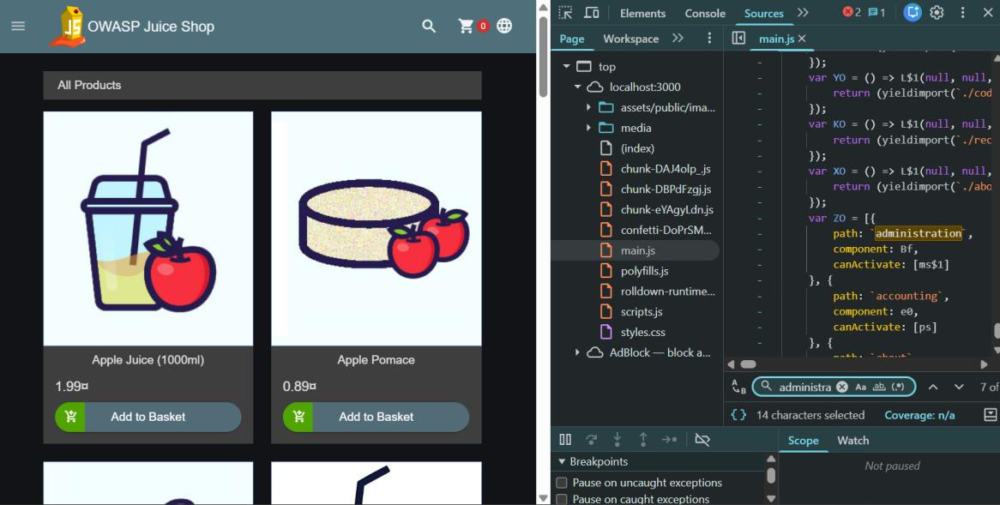
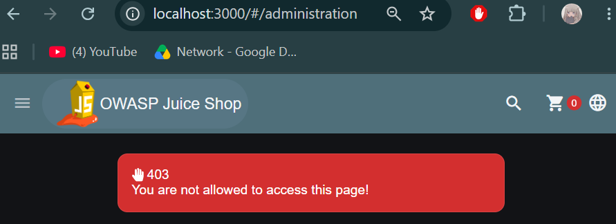
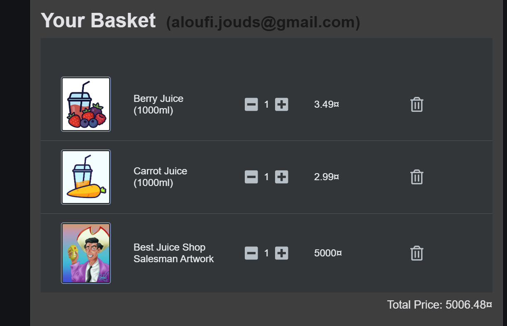
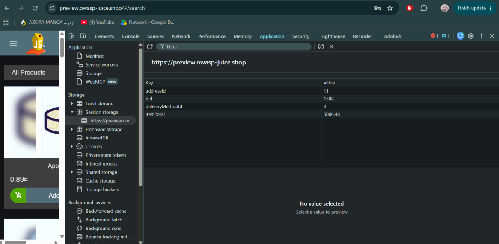
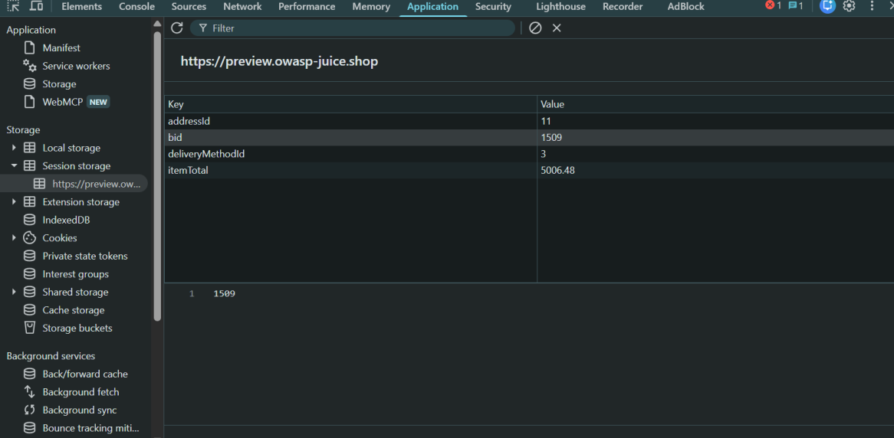
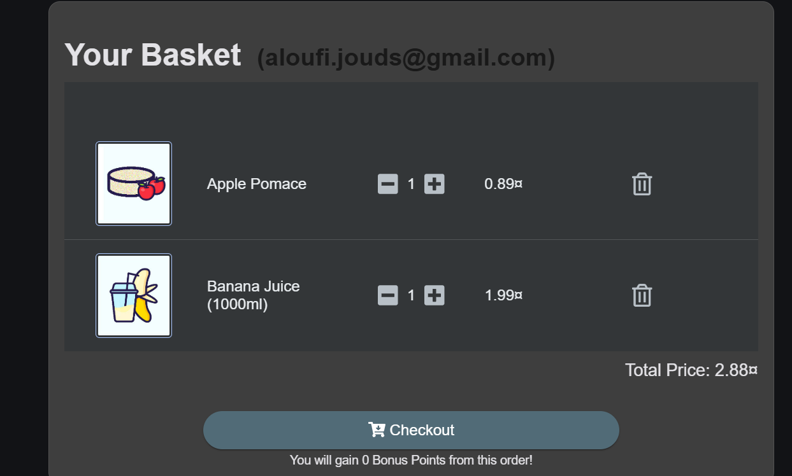
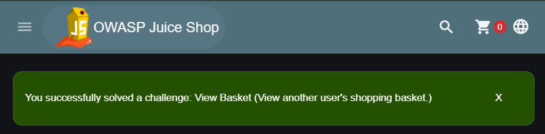

# Lab 01 · Access Control Pack

**Category:** A01 Broken Access Control &nbsp;·&nbsp; **Target:** OWASP Juice Shop &nbsp;·&nbsp; **Tools:** Browser DevTools

## Lab Description

> Two sides of broken access control in one exercise: reaching an admin-only route as a normal user (vertical), then viewing another customer's basket by editing an ID the client is trusted to hold (horizontal).

## Overview

Access control decides who is allowed to do or see what. It breaks in two directions. **Vertical** is a lower-privilege user reaching something meant for a higher role, like a normal user opening an admin page. **Horizontal** is one user reaching another user's data at the same level, usually by changing an identifier the client was trusted to send. The rule to remember is that the browser can never be where access is decided.

## Part 1 · Admin route discovery (vertical)

On the main page I opened DevTools, went to **Sources**, and searched for "administration" to find the route.

The admin route is sitting in the client-side JavaScript bundle, so anyone can discover it just by reading the code the browser already downloaded.

I then tried to open `/administration` directly, but the website denied the request with a `403`.

Here the server actually does its job: the `403` is correct behaviour. The only weakness is that the route is discoverable in the client bundle at all. This half is a good contrast to Part 2, where the server does *not* check.

## Part 2 · Viewing another basket (horizontal / IDOR)

For the horizontal case I first added a few items to my own basket.

This is my own basket, the baseline before I try to load someone else's.

Then I opened DevTools, went to **Application → Session storage**, and found the basket id stored under the key `bid`.

The basket is identified by a simple number (`bid`) held on the client side, which means I can change it.

I changed the `bid` by one (+1), pointing it at a basket that isn't mine.

Incrementing the id points the app at the next basket in sequence, one that should not be mine to see.

The basket now shows a different set of items, ones I never added. The server returned whatever basket the id named, without checking it belongs to me.

The challenge is marked solved, confirming the IDOR worked.

## Root cause, impact and fix

| | |
| --- | --- |
| **Root cause** | The basket id is a simple number the client is trusted to hold, and the server returns whatever basket that id names without checking it belongs to the logged-in user (an Insecure Direct Object Reference). |
| **Impact** | Any user can read another user's basket by editing one value. |
| **Fix** | Check ownership on the server for every request: the basket a user asks for must be tied to their own session, not just to the id they send. Predictable ids are only a secondary concern. |
| **Where authorization belongs** | Server-side, at the API and database layers. The UI can hide options for tidiness, but it can never enforce them, and the server must never trust client-supplied identifiers (basket IDs, user IDs, account numbers) without an ownership check. |
