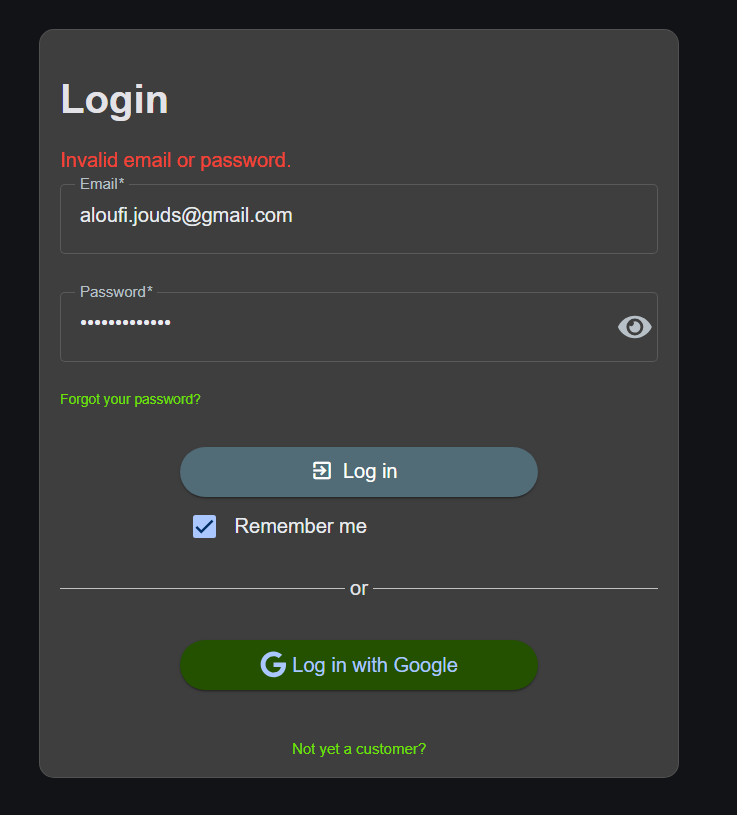
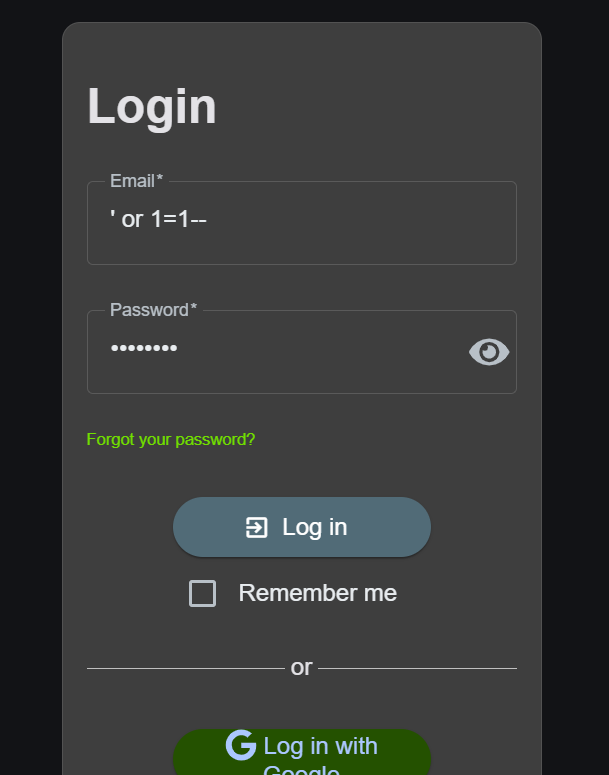
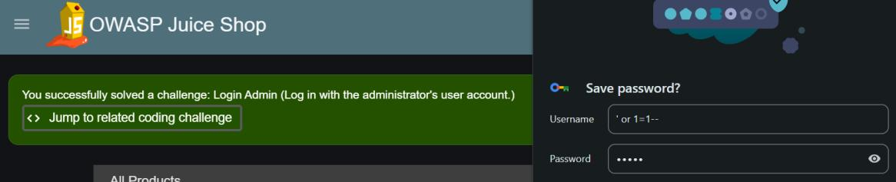
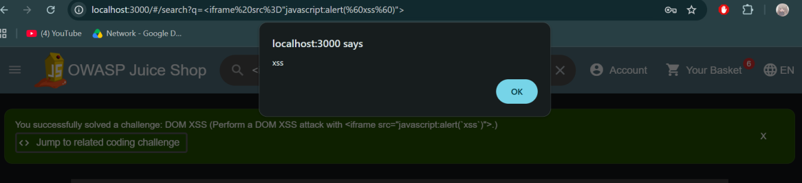
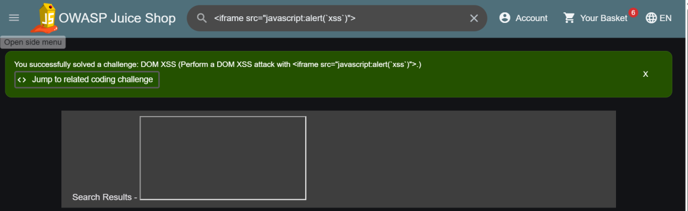

# Lab 03 · Injection Pack

**Category:** A03 Injection &nbsp;·&nbsp; **Target:** OWASP Juice Shop &nbsp;·&nbsp; **Tools:** Browser

## Lab Description

> Two classic injection flaws in one exercise: bypassing the login with SQL injection, then firing a DOM-based XSS payload through the search box.

## Overview

Injection happens when user input is mixed into something that gets interpreted, a SQL query or an HTML page, instead of being treated as plain data. With **SQL injection**, crafted input changes the meaning of the database query. With **cross-site scripting (XSS)**, input is reflected into the page and the browser runs it as script. Both come down to the same root cause: data being parsed as code.

## Part 1 · SQL injection login

First I did one normal login with the wrong details to see the baseline behaviour. The app rejects it with "Invalid email or password."

This is the normal failure, so I know what a rejected login looks like before I try to bypass it.

I then tried in the Email field a SQLi-style input `' or 1=1--`. Any password will do, since the injected condition is always true and the trailing comment removes the rest of the query.

The payload closes the string early, adds an always-true condition, and comments out the password check.

It logged straight into the administrator account. The database returned the first matching user because the `WHERE` clause was forced true.

## Part 2 · DOM XSS via search

For the second part I entered the payload `<iframe src="javascript:alert(\`xss\`)">` in the Search field.

The search term is a payload, not a search. If the app puts it on the page without cleaning it, the browser will build a real iframe.

The alert fires, which proves the browser treated my input as a live element and ran the JavaScript inside it.

Juice Shop confirms the DOM XSS challenge is solved.

## Root cause, impact and fix

| | |
| --- | --- |
| **SQLi root cause** | The login query pastes the email straight into the SQL string, so the quote and comment change the query's meaning. **Fix:** use prepared statements, so input is bound as data and never parsed as SQL. |
| **XSS root cause** | The search term is written to the page without encoding, so the browser builds a real tag. **Fix:** treat all input as text, encode output so `<` and `>` display as characters, and add a Content-Security-Policy. |

**Real impacts of XSS (not just `alert`):**
- **Session hijacking:** stealing cookies or session tokens to take over the account.
- **Credential theft:** capturing passwords or sensitive text with an injected keylogger.
- **Unauthorized actions:** forcing the browser to make hidden API requests (changing settings, making purchases) using the victim's permissions.
