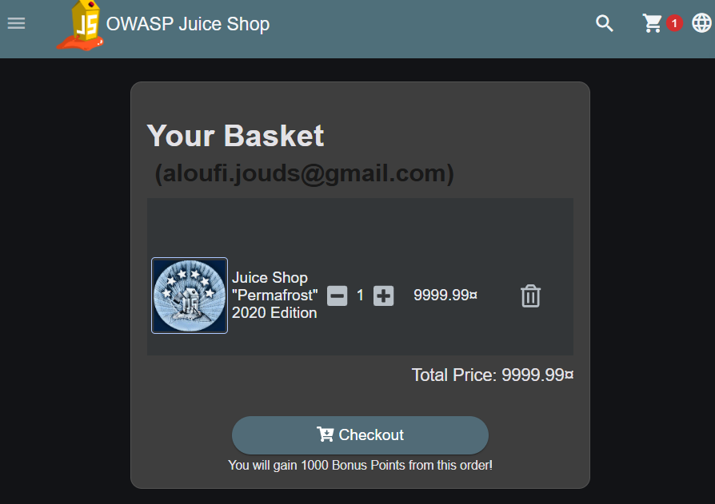
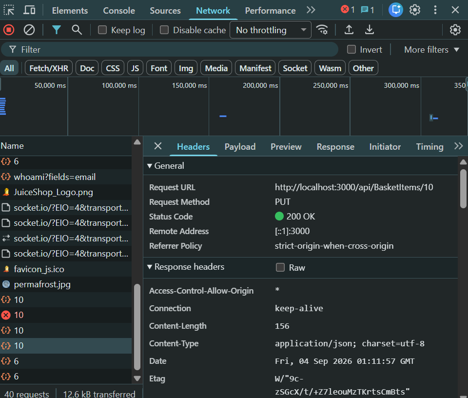
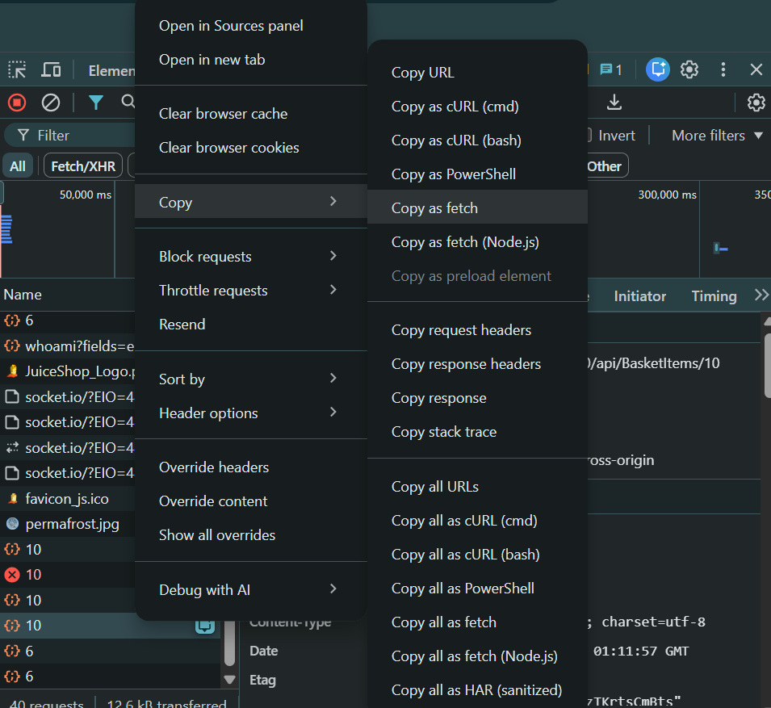
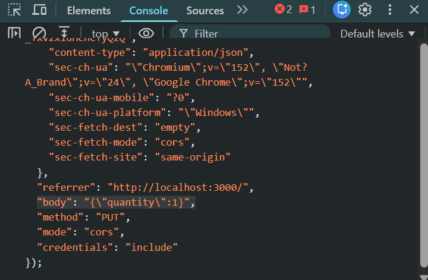
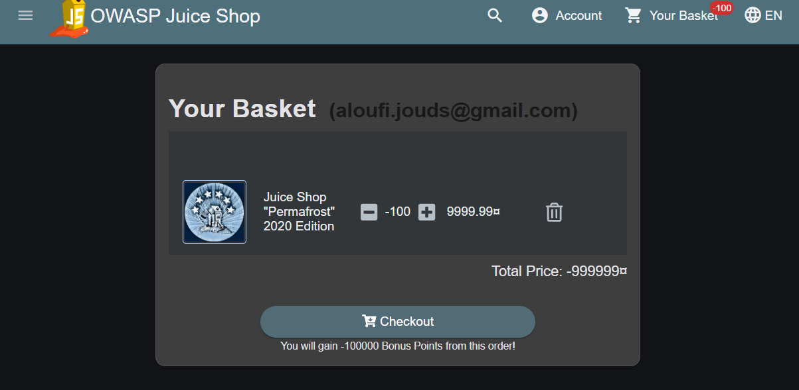
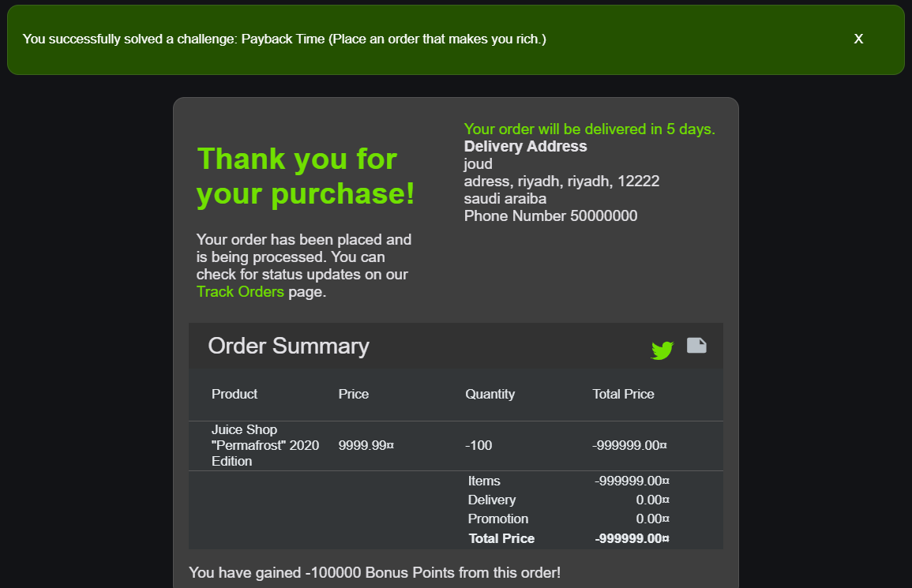

# Lab 04 · Payback Time

**Category:** A06 Insecure Design &nbsp;·&nbsp; **Target:** OWASP Juice Shop &nbsp;·&nbsp; **Tools:** Browser DevTools

## Lab Description

> Force a negative basket total to make the shop pay you instead of charging you, by sending a value the user interface would never allow.

## Overview

Insecure design is not a single bug you can patch; it is a missing rule. The application assumes the quantity is always a positive number because the UI only lets you pick positive numbers. But the UI is not the server. If the server never enforces "quantity must be at least 1" and "a total can't go below zero", the attacker just talks to the API directly and breaks the assumption the whole design rested on.

## Solution

Logged in as a normal user, I added the most highly priced product I could find to the basket. That was the Juice Shop "Permafrost" 2020 Edition at 9999.99.

I start with the most expensive item so the effect of a negative quantity is large and obvious.

With DevTools open on the **Network** tab, I changed the quantity in the UI and watched for the request that carries the update. It is a `PUT` to `/api/BasketItems/<id>`, and the server answers `200 OK`.

This identifies the exact request the app uses to update a basket line, which is the one I need to tamper with.

I used **Copy as fetch** from the Network tab so I had the whole call, headers and body, ready to edit.

Copying the full call lets me replay it from the console with my own changes, bypassing the form entirely.

Here is the request pasted into the console, with the quantity sitting at its original value of `1` before I edit it.

Then I changed it to `-100`. In the web page the lowest you can go is 1, but sending the request straight to the API lets me push past that limit into a negative number.

This is the key move: a negative quantity the UI would never submit, sent directly to the API.

The basket now shows `-100` units and a total of `-999999`. The negative quantity made the whole total negative.

I went to checkout and completed the order. Because the total is negative the shop credits the wallet instead of charging it.

The order that should have cost ten thousand instead pays me, and the challenge is solved.

## Root cause, impact and fix

| | |
| --- | --- |
| **Missing invariants** | Quantity must be a whole number of at least 1; an order total must never be below 0; wallet debits must be non-negative. |
| **Why UI limits don't help** | The attacker talks directly to the API, so any limit that only lives in the browser is irrelevant. |
| **Why it's a design problem** | The application relied on frontend limitations instead of enforcing the rules on the server. |
| **Fix** | Validate every basket update on the server, reject any order whose total is below 0, only ever debit a wallet by a positive amount, and add database `CHECK` constraints such as `quantity >= 1`. |
