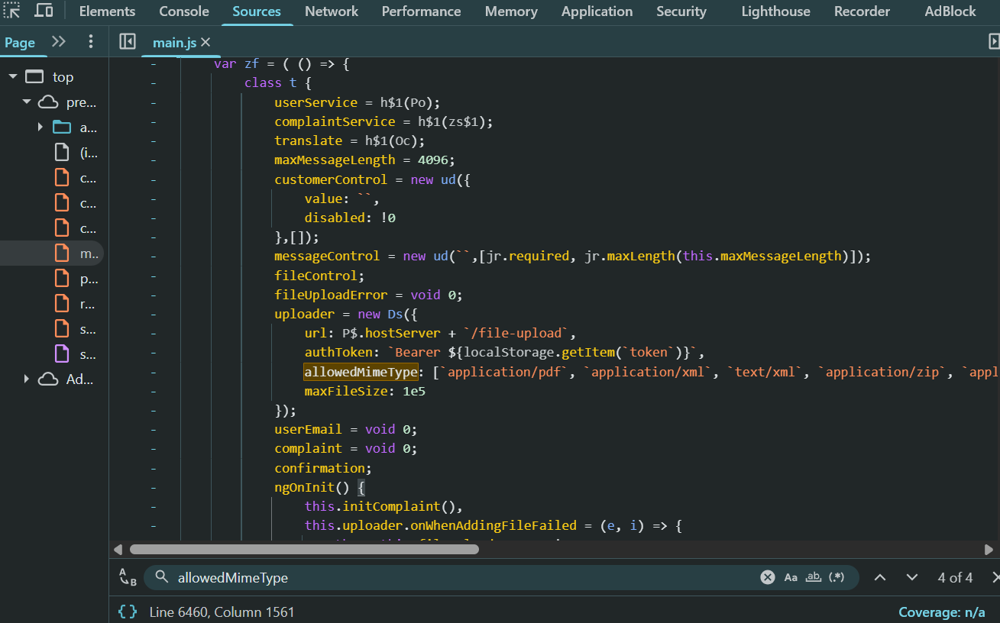
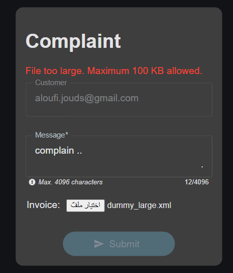
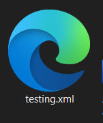
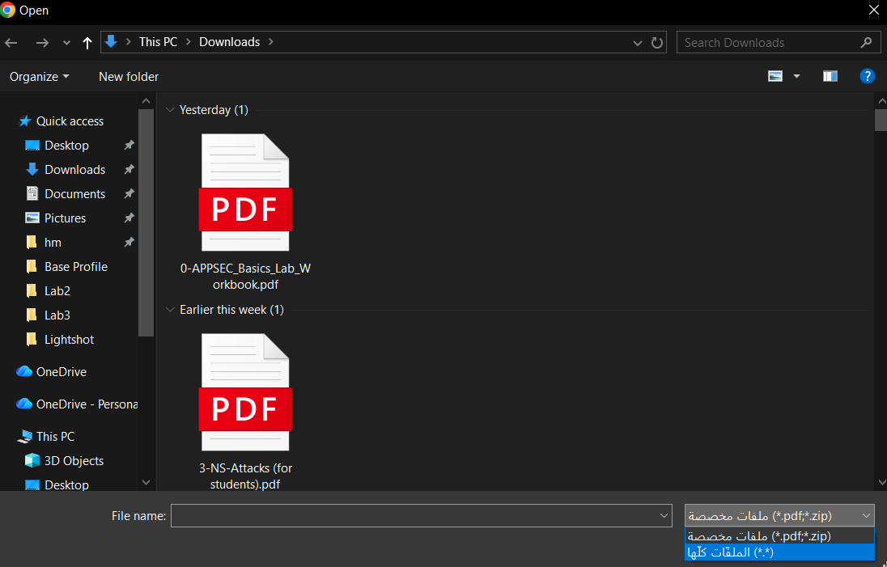
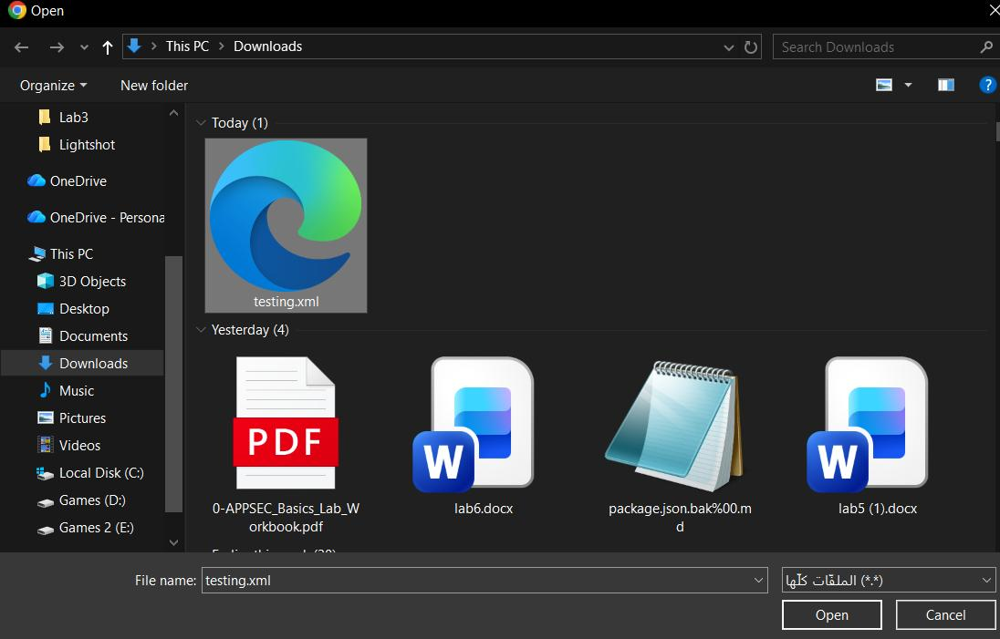
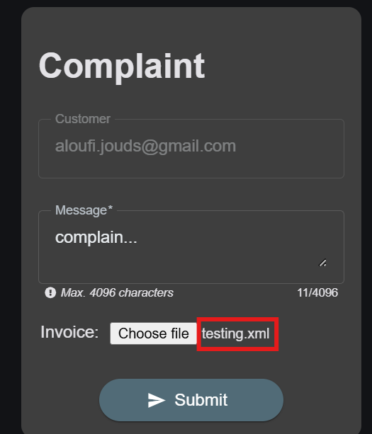
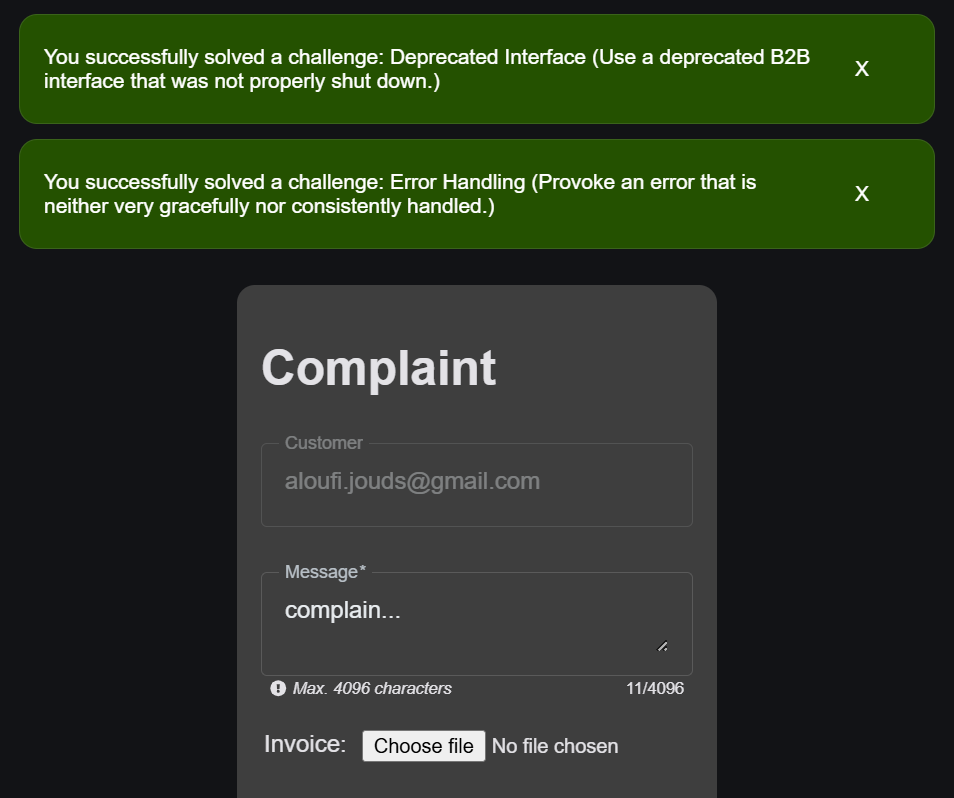
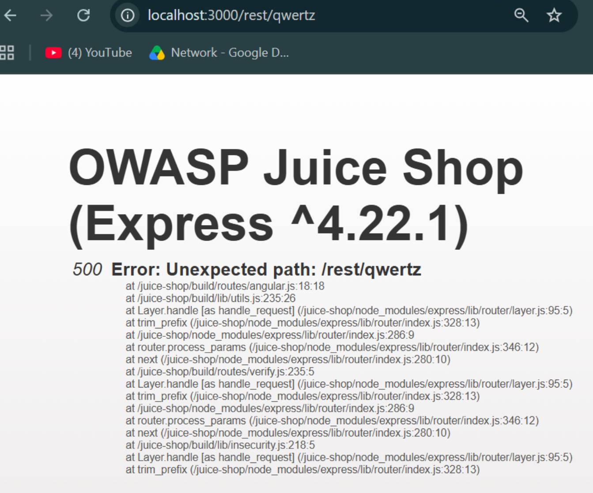

# Lab 05 · Deprecated Interface

**Category:** A05 Security Misconfiguration &nbsp;·&nbsp; **Target:** OWASP Juice Shop &nbsp;·&nbsp; **Tools:** Browser DevTools

## Lab Description

> A retired B2B file-upload path is still wired up behind the complaint form. Reading the client code reveals it, and an old XML type still slips through. An optional add-on checks whether the server leaks internal details on error.

## Overview

Security misconfiguration is often about what was left behind. A feature gets "removed" from the interface but its code, and the endpoint behind it, stay in place. If the client still lists an old file type as allowed and the server still accepts it, the feature is not gone, it is just hidden. Hidden is not the same as disabled.

## Part 1 · Reading the upload config

On the complaint page I opened DevTools, went to **Sources**, opened `main.js` and searched for "allowedMimeType". Among the allowed types I found XML.

The client still lists `application/xml` and `text/xml` as allowed, even though the XML upload was supposedly retired. The code that permits it was never removed.

## Part 2 · Building and uploading the file

I created an XML file smaller than 100 KB, because anything over that size is rejected with a "File too large" message. That size cap is the one limit the form does enforce.

This shows the single limit that *is* enforced, the size cap, so I know to keep my file under it.

A small `testing.xml`, kept under the size limit, is the file I'll try to sneak through.

In the complaint form I clicked **Choose File**. The picker only offered PDF and ZIP, but switching the filter to "All files" made the XML file selectable.

The picker's PDF/ZIP filter looks like a restriction, but it is only a convenience hint.

Switching to "All files" ignores that hint completely and lets me select the XML.

The server accepted the file with no error, because it still allows the old XML type.

Submitting the complaint solved two challenges at once: Deprecated Interface, and the Error Handling add-on below.

## Part 3 · Error handling add-on

Visiting an endpoint that doesn't exist is enough to test whether the server leaks internal detail: `http://localhost:3000/rest/qwertz`. Instead of a tidy message it returns a full `500` page with a raw stack trace, even naming the framework and version (Express 4.22.1).

The stack trace and version string are exactly the kind of internal detail an attacker uses to find known vulnerabilities for that framework.

## Root cause, impact and fix

| | |
| --- | --- |
| **Root cause** | A deprecated endpoint was hidden from the UI but never removed, and the server still accepts the old XML type; errors are not handled uniformly, so one path leaks a stack trace. |
| **Impact** | A retired, unmaintained upload path stays reachable, and error pages hand an attacker the framework and version. |
| **Fix** | Delete dead endpoints instead of hiding them, validate uploads by actual file content (magic bytes) on the server, keep the allow-list server-side, and return generic error pages while logging detail internally. |
