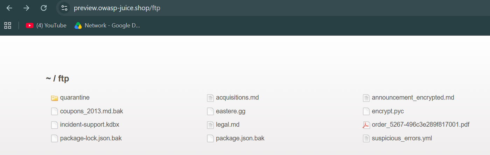
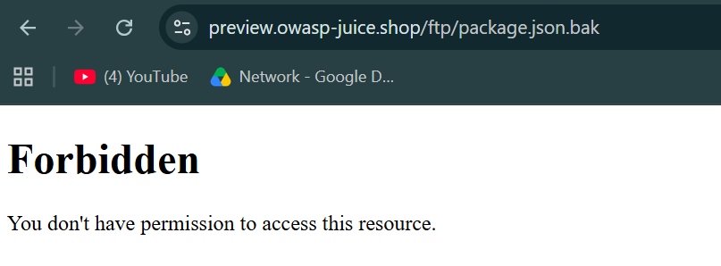
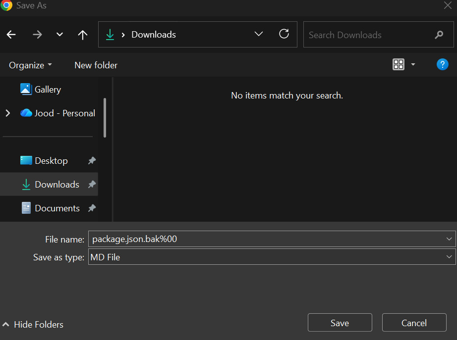
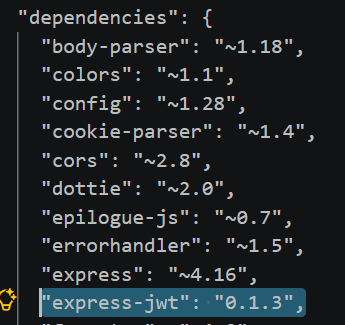
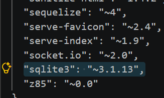
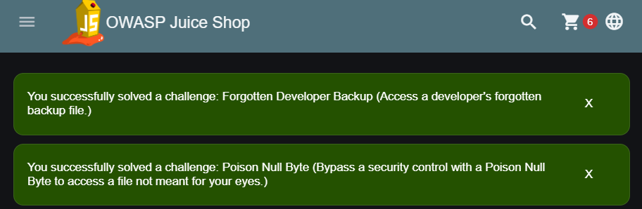

# Lab 06 · Forgotten Developer Backup

**Category:** A06 Vulnerable & Outdated Components &nbsp;·&nbsp; **Target:** OWASP Juice Shop &nbsp;·&nbsp; **Tools:** Browser

## Lab Description

> Reach a developer's forgotten backup file by defeating the filetype filter with a Poison Null Byte, then inspect the recovered file for vulnerable dependencies.

## Overview

Two problems meet here. First, build and backup artifacts (like `package.json.bak`) get left in a public folder where they were never meant to be reachable. Second, the filter that is supposed to block them can be fooled with a **Poison Null Byte**: the check and the file-system lookup read the path differently, and that disagreement is the hole. Once the backup is recovered, its dependency list is a map of known-vulnerable components.

## Part 1 · Finding and reaching the backup

Juice Shop exposes a directory at `/ftp` that is meant to be internal. Browsing to it lists files that were never supposed to be public, including a developer's forgotten backup.

The `/ftp` listing itself is the first problem: internal files, including `package.json.bak`, are publicly browsable.

Opening `package.json.bak` directly does not work. The server allows only a short list of extensions from `/ftp`, and `.bak` is not one of them, so the request is refused with `403 Forbidden`.

So there *is* a filter: `.bak` is blocked. The next step is to get past it.

To get around the extension filter I used the Poison Null Byte bypass. I added `%2500.md` to the end of the URL.

`%2500` is the URL-encoding of a null byte. The filter reads the `.md` on the end and allows it, but the file system stops reading at the null byte and returns `package.json.bak`. The check and the lookup disagree, and that gap is the vulnerability.

The browser offers the real backup file to save, which proves the trick reached the file system rather than being cleaned up on the way in.

The backup is recovered. Now I can read what is inside it.

## Part 2 · Inspecting the dependencies

With the backup recovered, I looked through its dependency list. Two entries stand out as known vulnerable versions.

`express-jwt 0.1.3` suffers from a critical authorization-bypass flaw.

`sqlite3 ~3.1.13` is an old version carrying known issues such as denial of service and improper input handling.

Both challenges are solved: reaching the file, and the Poison Null Byte technique used to get past the filter.

## Root cause, impact and fix

| | |
| --- | --- |
| **Root cause** | A backup artifact is left in a public folder, and the extension filter decodes the path inconsistently, so a null byte disguises `.bak` as `.md`. |
| **Impact** | An attacker recovers the backup and reads the full dependency list, exposing known-vulnerable components to target next. |
| **Fix** | Decode the path fully before checking it and reject any request containing a null byte; validate type against a strict allow-list after decoding; pin dependencies to patched versions and enforce them in CI (npm audit, Dependabot); exclude build artifacts like `package.json.bak` from deployable images. |
