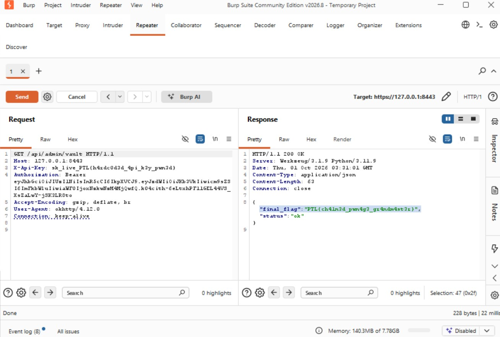
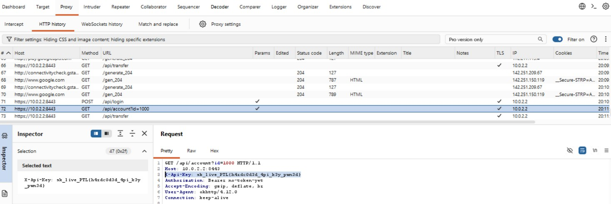
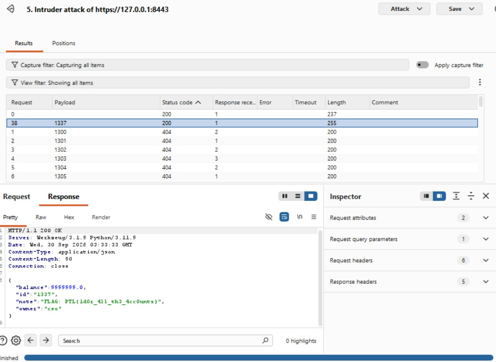
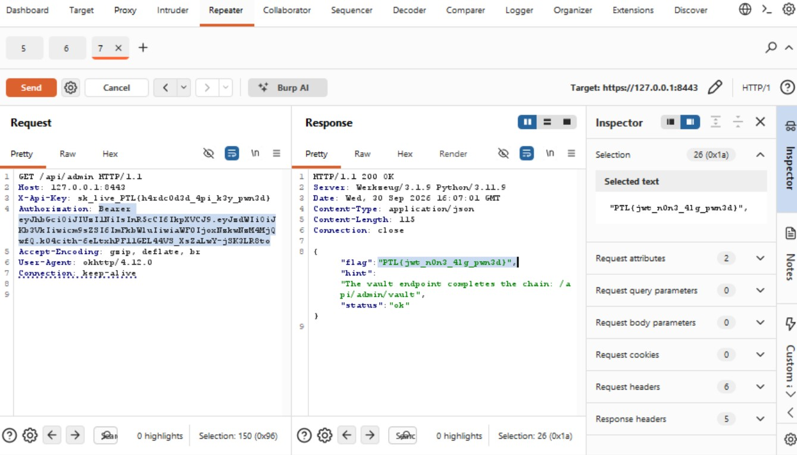
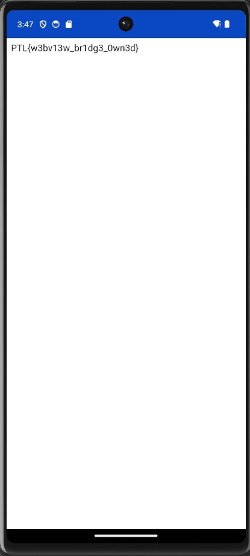
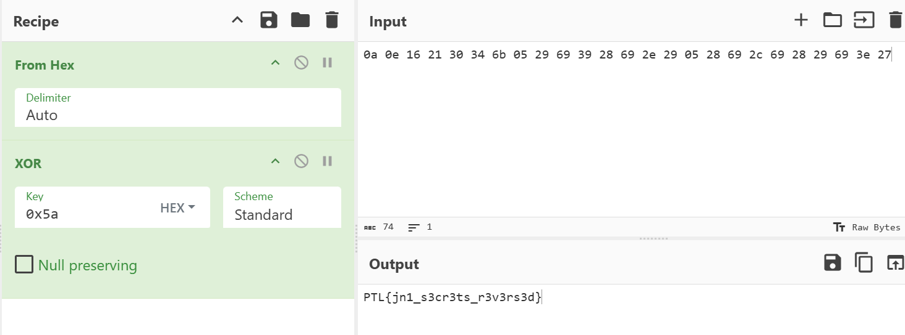
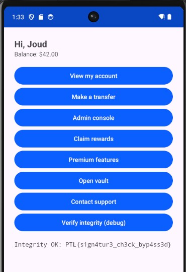
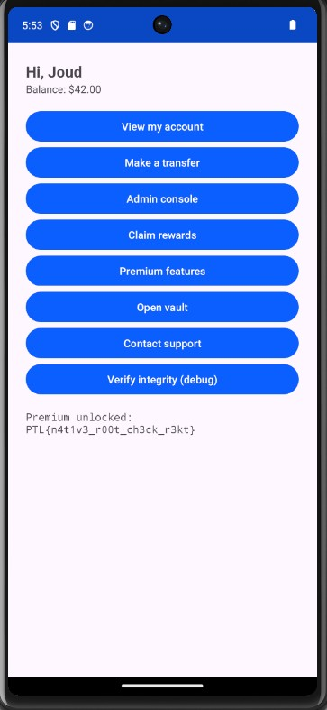

# VaultBank Mobile Pentest — Hard & Insane Tiers

Mobile application penetration-testing lab from the Cybersecurity Solutions & Analytics Bootcamp (Kaspersky & Tuwaiq Academy). VaultBank is a deliberately vulnerable Android training app; every challenge is a known planted weakness.

**Tools:** apktool, jadx, adb, Frida, objection, Burp Suite, CyberChef, jwt_tool, Ghidra

## Executive summary
This report covers the eight Hard and Insane challenges of the VaultBank lab. The Hard tier moves off the device into the network, token handling, the WebView bridge and a native root check. The Insane tier reverses a native secret, defeats a self-integrity check, and chains the earlier bugs into full access to the vault. The theme is the same throughout: anything that runs on a device the attacker controls can be read or bypassed. A pin, a root check, an integrity check and an obfuscated secret all failed for the same reason, they trusted the client.

**Severity spread:** 1 Critical, 4 High, 2 Medium, 1 Low.

## Scope and methodology
Target: the VaultBank Android app (APK) and its mock API, tested on a rooted emulator. The Hard network challenges talk to a local backend reached at 10.0.2.2:8443 from the emulator. Testing combined static analysis of the decompiled app (jadx) and the native library (Ghidra) with dynamic analysis: an intercepting proxy (Burp), runtime instrumentation (Frida and objection), and token tampering (jwt_tool, CyberChef).

## Findings
Findings are ordered by severity, highest first.

### X3 · Grandmaster — Critical
The vault endpoint `/api/admin/vault` is the final target. It is not a new bug, it is H1, H2 and H3 chained: the pin bypass opens the traffic, the session gives the request shape, and the forged admin token opens the vault.

Chaining H1, H2 and H3 opens the vault endpoint, which returns the final flag. One strong control anywhere in the chain would have stopped this.

- **Impact:** Three issues that are each serious combine into full access to the vault. Security is only as strong as the weakest link.
- **Remediation:** Fix each link. Any one strong control, a real pin, a strong JWT secret, or a server-side access check, would break the chain.

### H1 · Pinning is not enough — High
The app pins the server certificate, so an intercepting proxy cannot read the traffic even after its CA is trusted on the device. The pin runs inside the app, so it can be switched off at runtime. Once the traffic is readable, the request carries a live payment API key that starts with `sk_live_`.

Once the certificate pin is switched off at runtime, Burp can read the request, and the request carries a hardcoded live API key starting with `sk_live_`.

- **Impact:** A pin that runs on a device the attacker controls can be removed, which exposes all of the API traffic. The hardcoded key then works against the real payment account.
- **Remediation:** Treat pinning as one layer, not the only control. Keep live keys off the client, route payment calls through a backend, and rotate the exposed key.

### H2 · Every account is your account — High
Once the traffic is readable, the account endpoint returns any account id it is given, without checking that the account belongs to the caller. Login needs only a username and returns a JWT.

Walking the account id in Intruder returns whichever account I ask for, which confirms the broken object access across accounts.

- **Impact:** With one valid token an attacker can read every account by walking the id values. This is IDOR, a direct broken access control bug.
- **Remediation:** Check on the server that the requested object belongs to the caller. Never rely on the client to ask only for its own id.

### H3 · Become the admin — High
The admin endpoint reads the role claim inside the JWT to decide who is an admin. The token is signed with HS256, and the signing secret is weak.

A JWT forged with the weak HS256 secret is accepted as an admin token, so the admin-only endpoint responds.

- **Impact:** A weak HS256 secret lets an attacker forge a token with role admin and reach admin-only endpoints.
- **Remediation:** Use a long random signing key, verify the algorithm server-side, and never trust a claim the client can change.

### H4 · Bridge to nowhere good — High
The support screen loads a WebView that trusts whatever url it is told to load, and it bridges a Java object into the page with `addJavascriptInterface`. Any page it opens can call `Android.getFlag()`.

A page loaded in the WebView calls the bridged Java object directly (`Android.getFlag()`) and gets the flag back.

- **Impact:** A JavaScript bridge plus an attacker controlled url lets a web page call app code. A hostile page could reach any method the bridge exposes.
- **Remediation:** Do not expose a bridge to untrusted content, and never load a url the app does not control.

### X1 · Secrets in the machine — Medium
The vault secret is not stored in clear. `nativeSecret` in `libnativevault.so` holds the secret XOR-encoded and decodes it at runtime with the single byte key `0x5a`. It also has an anti-debug trap, but the trap backfires: a normal user with no debugger attached sees the real secret rendered straight on the vault screen, and only a debugger is handed a decoy flag.

The native secret is only XOR-encoded with a single-byte key that ships inside the code, so it rebuilds offline in seconds.

- **Impact:** The protection adds nothing. The secret is shown to any normal user on screen, the XOR key ships inside the code, and the secret can also be rebuilt offline from the code.
- **Remediation:** Do not rely on client-side obfuscation for secrets. Keep real secrets off the device.

### X2 · Tamper-evident — Medium
A debug feature checks the app's own signing certificate against a stored vendor hash and unlocks only on a match. The check, `isOriginal`, runs in the app and returns a boolean, so it can be forced to true.

The client-side integrity check just returns a boolean, so forcing it to true passes the check.

- **Impact:** An integrity check that runs on the client can be flipped by the attacker. It cannot prove the app is unmodified.
- **Remediation:** Do not rely on a client-side integrity check. If integrity matters, use server-side attestation.

### H5 · Root check, in C — Low
A premium feature refuses to run on a rooted device. The check is in native code, `nativeIsRooted` in `libnativevault.so`, but it is only a shallow lookup: it searches for an su binary in a fixed list of paths and returns a boolean. A device rooted without su in those paths passes the check with no tooling at all.

The native root check is also just a boolean; forcing it to return false runs the feature on a rooted device.

- **Impact:** A root check that runs in the app, native or not, can be flipped with Frida, and this one is even weaker: it misses any root that does not drop su in the paths it scans.
- **Remediation:** Do not rely on a client-side root check as a control. Enforce sensitive logic server-side.

## Summary

| ID | Weakness | Severity |
| --- | --- | --- |
| X3 | Chaining H1, H2 and H3 to reach the vault | Critical |
| H1 | Certificate pin bypassed, live API key exposed | High |
| H2 | Broken object access (IDOR) across accounts | High |
| H3 | Forged admin JWT from a cracked signing secret | High |
| H4 | WebView JavaScript bridge reachable with an attacker url | High |
| X1 | Native secret recoverable from XOR obfuscation | Medium |
| X2 | Signature integrity check bypassable at runtime | Medium |
| H5 | Native root check bypassable | Low |

## Recommendations
- Keep secrets and keys off the client. Keys and tokens belong on a server, not in generated code, resources, or a native library.
- Pinning, root checks and integrity checks are speed bumps, not controls. Anything that runs on the device can be bypassed.
- Put authorization on the server. Check that every object and every admin action belongs to the caller.
