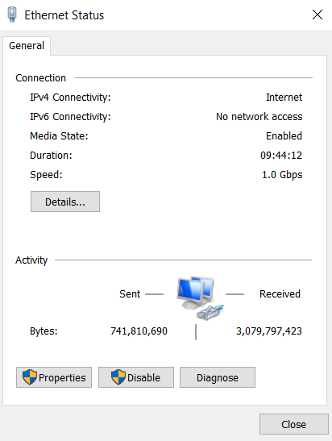

# Lab 01 · Following an email down the OSI stack

**Domain:** Network &nbsp;·&nbsp; **Tools:** Gmail, netstat, ipconfig, tracert, arp

## Purpose

To better understand the OSI model by following a single email through its layers, and to find what observable data on the system confirms each layer is doing its job.

## Overview

The OSI model splits communication into seven layers, from the application a person uses down to the physical medium that carries the bits. Each layer has a job, and each one leaves evidence you can observe with ordinary tools. This lab sends one email and then looks, layer by layer, for that evidence.

> **Note on screenshots:** the original screenshots here showed command output from my own machine (IP, MAC address, host name, email headers), so they have been left out of the public version. The walkthrough below describes exactly what each step showed.

## Walkthrough

**01 · Preparation.** I sent an email to myself in Gmail with the subject "Lab 1". Every later step is built on this one message.

**02 · Application (Layer 7).** The application layer is the part I actually see and touch, the Gmail interface. To reach the raw message I opened the email, clicked the three dots, and chose **Show original**.

**03 · Presentation (Layer 6).** "Show original" displays the MIME headers, where the message is described and encoded so any client can render it. There was no `Content-Transfer-Encoding` field, because the email has simple content and the system uses the default encoding without needing to state it.

**04 · Session (Layer 5).** The session layer opens, maintains and closes the conversation between the two hosts. The headers reported the session as taking 0 seconds. The real duration was under a second, but header timestamps only have one-second precision, so the difference can't be shown.

**05 · Transport (Layer 4).** I ran `netstat -an` to view the active TCP connections. Because I used web-based Gmail rather than a mail client, the traffic goes over port 443 (HTTPS) instead of the standard SMTP ports. An `ESTABLISHED` connection on 443 confirms the transport layer is maintaining a reliable session.

**06 · Network (Layer 3).** I ran `ipconfig /all` to find my own IP address and the default gateway, then `tracert gmail.com` to see the path towards Google's servers, seven hops from my gateway to Google's edge.

**07 · Data link (Layer 2).** This layer addresses devices on the local segment using MAC addresses. I used `ipconfig /all` to find my interface's MAC, then `arp -a` to find the gateway's MAC, the next physical hop the frame is handed to.

**08 · Physical (Layer 1).** At the bottom of the stack is the medium that actually carries the bits.

This is the adapter status: a wired connection at 1.0 Gbps. It is the one piece of evidence for the physical layer, the real link underneath everything above it.

## Takeaway

Every layer of the OSI model leaves something you can observe: the Gmail UI at Layer 7, MIME headers at Layer 6, an established socket at Layer 4, IP and route at Layer 3, MAC addresses at Layer 2, and the physical link at Layer 1. Tracing one message top to bottom makes the model concrete instead of abstract.
