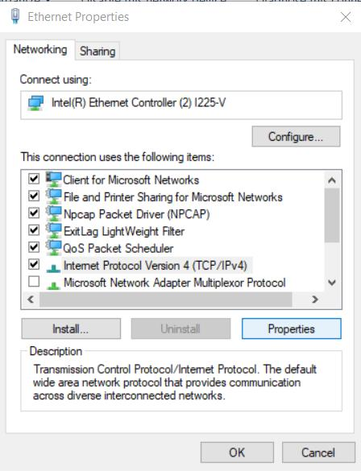
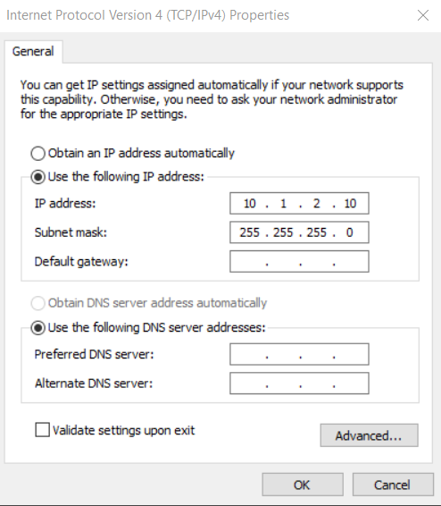
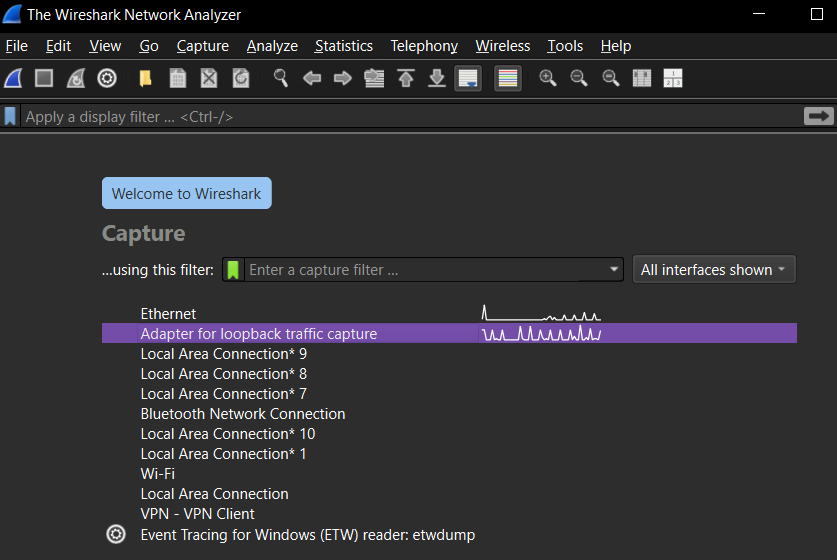
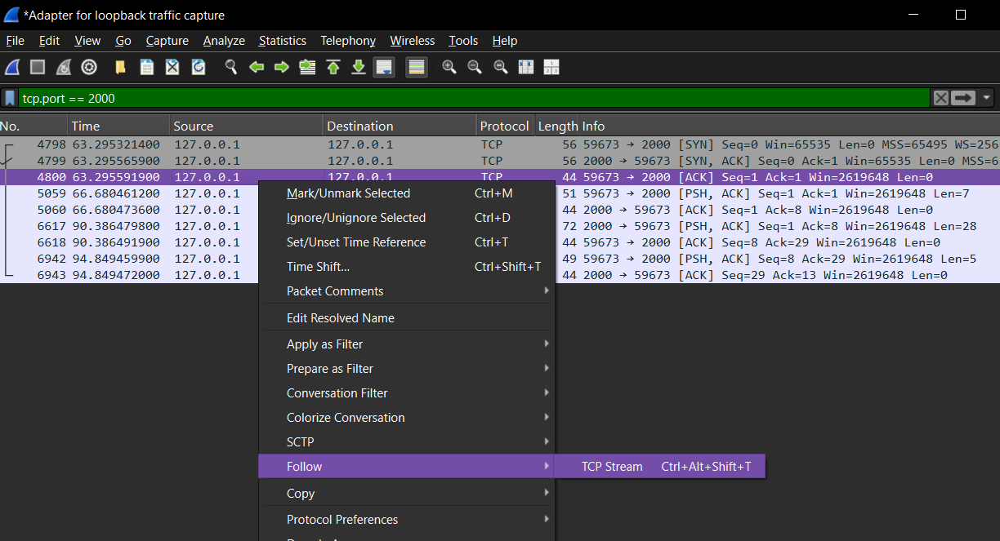
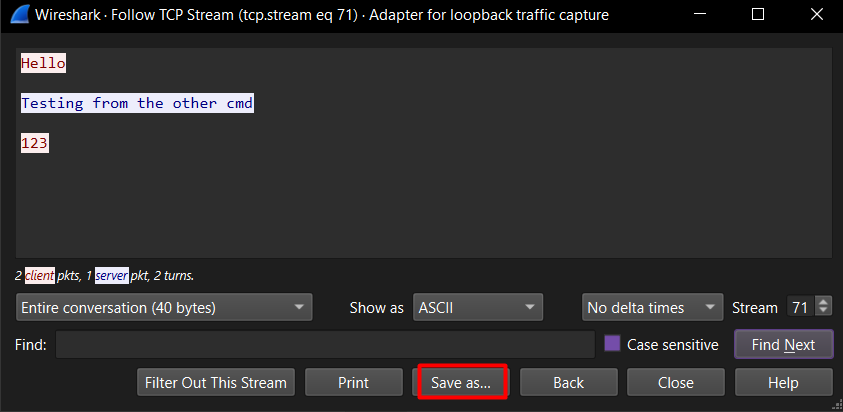
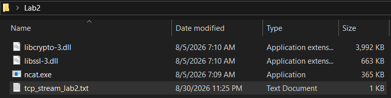
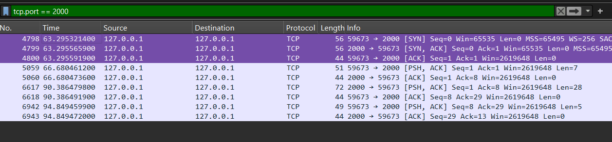
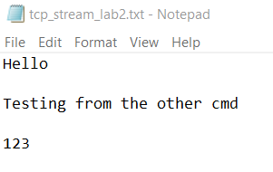

# Lab 02 · Addressing and subnetting

**Domain:** Network &nbsp;·&nbsp; **Tools:** ipconfig, Netcat, Wireshark

## Purpose

To practise IP addressing and subnetting by hand, assign network parameters to an interface, test special addresses (loopback, broadcast), and study IP/TCP/UDP with Netcat and a traffic capture.

## Overview

Subnetting is reading an address and its prefix length and working out, by hand, where a network starts, where it ends, and which addresses are usable. The second half puts theory into practice: set a static address, test loopback and broadcast, then use Netcat to generate a simple TCP conversation and read it back in Wireshark, all the way down to the three-way handshake.

> Some screenshots in this lab showed command output from my own machine, so they have been left out of the public version. The written steps describe what each showed.

## 01 · Address classification

Each address was classified by its leading octet, identified by the range it belongs to, and given the subnet mask implied by its prefix length.

| # | Address | Class | Type | Subnet mask |
| --- | --- | --- | --- | --- |
| 1 | 10.12.4.3/16 | A | Private | 255.255.0.0 |
| 2 | 172.20.14.200/20 | B | Private | 255.255.240.0 |
| 3 | 192.168.100.25/24 | C | Private | 255.255.255.0 |
| 4 | 127.0.0.5/8 | A | Loopback | 255.0.0.0 |
| 5 | 224.0.0.1/4 | D | Multicast | 240.0.0.0 |
| 6 | 169.254.10.11/16 | B | Link-local (APIPA) | 255.255.0.0 |
| 7 | 203.0.113.55/24 | C | TEST-NET-3 | 255.255.255.0 |
| 8 | 192.0.2.10/24 | C | TEST-NET-1 | 255.255.255.0 |

Network address, broadcast address and valid host range for each:

| # | Address | Network | Broadcast | Valid hosts |
| --- | --- | --- | --- | --- |
| 1 | 10.12.4.3/16 | 10.12.0.0 | 10.12.255.255 | 10.12.0.1 - 10.12.255.254 |
| 2 | 172.20.14.200/20 | 172.20.0.0 | 172.20.15.255 | 172.20.0.1 - 172.20.15.254 |
| 3 | 192.168.100.25/24 | 192.168.100.0 | 192.168.100.255 | 192.168.100.1 - 192.168.100.254 |
| 4 | 127.0.0.5/8 | 127.0.0.0 | 127.255.255.255 | reserved for loopback |
| 5 | 224.0.0.1/4 | n/a | n/a | multicast group, no network/host part |
| 6 | 169.254.10.11/16 | 169.254.0.0 | 169.254.255.255 | 169.254.0.1 - 169.254.255.254 |
| 7 | 203.0.113.55/24 | 203.0.113.0 | 203.0.113.255 | 203.0.113.1 - 203.0.113.254 |
| 8 | 192.0.2.10/24 | 192.0.2.0 | 192.0.2.255 | 192.0.2.1 - 192.0.2.254 |

192.0.2.0/24 and 203.0.113.0/24 are reserved by the IETF in RFC 5737 for documentation and teaching. The lab sheet didn't say so, but that is what they are: not ordinary public addresses.

## 02 · Subnet mask for /16 (10.12.4.3)

A /16 means the first sixteen bits belong to the network, so the first two octets are locked and the last two are free for hosts.

```
/16 = 11111111 . 11111111 . 00000000 . 00000000
       255     .   255    .    0     .    0
```

A full octet of ones is 255 and an empty one is 0, so the mask falls out immediately. The network keeps the locked octets and zeroes the rest; the broadcast is one step before the next network begins.

- Subnet mask: 255.255.0.0 · Network: 10.12.0.0 · Broadcast: 10.12.255.255
- First host: 10.12.0.1 · Last host: 10.12.255.254

## 03 · Subnet mask for /20 (172.20.14.200)

A /20 doesn't land on an octet boundary.

```
/20 = 11111111 . 11111111 . 11110000 . 00000000
       255     .   255    .   240    .    0
```

The third octet is 11110000 = 128+64+32+16 = 240, the "interesting" octet. Block size = 256 - 240 = 16, so networks step 0, 16, 32, 48... The address has 14 in the third octet, inside the first block (0-15).

- Subnet mask: 255.255.240.0 · Network: 172.20.0.0 · Broadcast: 172.20.15.255
- First host: 172.20.0.1 · Last host: 172.20.15.254

## 04 · Eight subnets

To create eight networks I borrowed bits from the host portion. Since 2³ = 8, three bits extend the original /16 to /19. Block size = 256 - 224 = 32.

| # | Network | Mask | Broadcast | First host | Last host |
| --- | --- | --- | --- | --- | --- |
| 1 | 10.1.0.0 | 255.255.224.0 | 10.1.31.255 | 10.1.0.1 | 10.1.31.254 |
| 2 | 10.1.32.0 | 255.255.224.0 | 10.1.63.255 | 10.1.32.1 | 10.1.63.254 |
| 3 | 10.1.64.0 | 255.255.224.0 | 10.1.95.255 | 10.1.64.1 | 10.1.95.254 |
| 4 | 10.1.96.0 | 255.255.224.0 | 10.1.127.255 | 10.1.96.1 | 10.1.127.254 |
| 5 | 10.1.128.0 | 255.255.224.0 | 10.1.159.255 | 10.1.128.1 | 10.1.159.254 |
| 6 | 10.1.160.0 | 255.255.224.0 | 10.1.191.255 | 10.1.160.1 | 10.1.191.254 |
| 7 | 10.1.192.0 | 255.255.224.0 | 10.1.223.255 | 10.1.192.1 | 10.1.223.254 |
| 8 | 10.1.224.0 | 255.255.224.0 | 10.1.255.255 | 10.1.224.1 | 10.1.255.254 |

## 05 · Interfaces and static IP

I listed the available interfaces with `ipconfig /all` (active Ethernet with a private IPv4, Wi-Fi disconnected, plus a VPN adapter and Bluetooth connection that were present but not connected). To set a static address I opened **Network Connections**, right-clicked the Ethernet adapter and chose Properties.



In the adapter properties I selected **Internet Protocol Version 4 (TCP/IPv4)** to open its settings, which is where a manual address is entered.



Here I switched to "Use the following IP address" and entered an address taken from the first subnet I calculated earlier, along with its mask, instead of letting DHCP assign one.

## 06 · Special addresses

- **Loopback:** pinging 127.0.0.1 shows the computer's own TCP/IP stack and drivers work; it never reaches the network.
- **Broadcast:** pinging the subnet broadcast reaches every host on the local segment, and several machines answered. I used the real local addresses for this, since the theoretical 10.1.x.x network has no live hosts.

| Packet type | How the system handles it |
| --- | --- |
| Loopback | Processed locally; never reaches the network. |
| Broadcast | Sent to the network and delivered to every host in the subnet. |
| Multicast | Sent to the network, but delivered only to hosts listening for that group. |

## 07 · Netcat

With `ncat.exe` and its two DLLs in one folder, one prompt listens and the other connects, so anything typed in either window appears in the other:

```
server:  ncat -l -p 2000 -v
client:  ncat -v 127.0.0.1 2000
```

## 08 · Wireshark

Because both ends of the chat are on 127.0.0.1, the traffic never leaves the machine, so I captured on the loopback adapter.



Loopback is the right interface precisely because a 127.0.0.1 conversation never touches a physical adapter.



Filtering with `tcp.port == 2000` narrows the capture to just the Netcat chat, hiding unrelated traffic.



Right-clicking a packet and choosing **Follow → TCP Stream** reassembles the whole conversation into one readable view, which I can then export.



Here I save that reassembled stream to a text file so I can compare it against what I actually typed.



The three highlighted packets are the TCP three-way handshake (SYN, SYN-ACK, ACK) that sets up the connection. Everything below them (PSH/ACK pairs) carries the actual typed messages.



The exported text matches, character for character, the messages I typed between the client and server windows, confirming the capture is complete.

**Client vs server:** the client is the side that sends the first SYN, and the server responds with SYN-ACK. In this capture that makes port 59673 the client and port 2000 the server.

## Takeaway

Subnetting by hand is just reading the prefix and finding block boundaries. Pairing that with a real Netcat conversation captured in Wireshark connects the math to what actually moves on the wire, down to the handshake that opens every TCP session.
