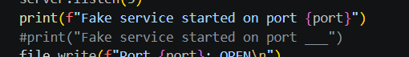
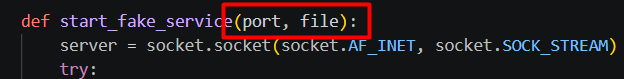
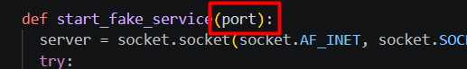
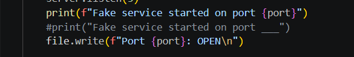
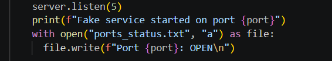
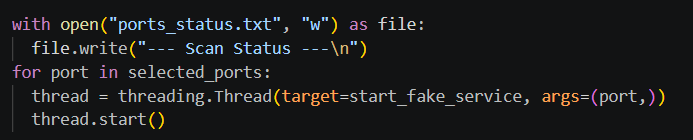
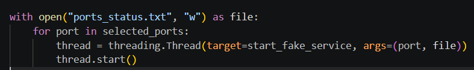
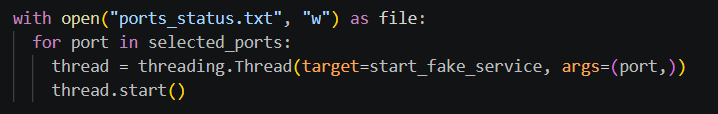
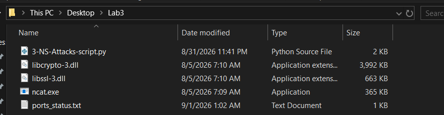
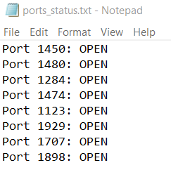

# Lab 03 · Security audits and scans

**Domain:** Network &nbsp;·&nbsp; **Tools:** Python, Nmap, netstat

## Purpose

To get hands-on with port scanning on a local system: run a Python script that simulates fake services, fix it where it was broken, and read back which ports it opened.

## Overview

A port scan asks a host which ports are listening. This lab works from the other side: a script that *opens* a set of fake service ports and logs them. The script shipped broken, so the first real task was debugging a threading and file-handling bug, which is a useful reminder that tooling fails in ordinary ways (a file closed before its threads finish writing), not just in exotic ones.

> The two screenshots that showed a local file path have been left out of the public version; the steps below describe them.

## 01 · The first run

Running the script produced a wall of errors. The fake services start, and each prints the port it grabbed, but the moment a thread tries to write its line to the log, it falls over. Every traceback points to the same place: line 16, `file.write`, raising `ValueError: I/O operation on closed file`. The main loop opens the log with a `with` block and then starts the threads inside it, so the `with` block closes the file long before the threads get round to writing.

## 02 · Fixing the script

**Fix 1 - show the real port number.** The script printed a placeholder instead of the port it had just opened, so I swapped the commented and active print lines.

Before the fix, the line that would print the real port was commented out, so the output showed blanks.

After swapping the lines, the active statement prints the actual port each fake service opened.

**Fix 2 - remove the file argument.** I made each thread handle its own file writing instead of sharing one handle.

Before: the function received both a port and a shared file handle, which is the handle that gets closed too early.

After: the function takes only the port, so there is no shared handle to go stale.

**Fix 3 - open the file inside the thread.** Each thread now opens the log itself in append mode (`"a"`), so the file is guaranteed open when it writes.

Before: the thread wrote through the outside handle, the root of the "closed file" error.

After: the thread opens `ports_status.txt` itself, so the file is open at the exact moment it writes.

This shows the corrected logic settled at the bottom of the script.

**Fix 4 - the main loop.** I removed `file` from `args=(port, file)` since the thread no longer needs it.

Before: the thread was started with the now-unnecessary file argument.

After: just `args=(port,)`, matching the function's new signature.

## 03 · The result

With the four fixes in place the script runs cleanly and every fake service reports the port it opened. The program writes `ports_status.txt` in the same folder.

The log file is created next to the script, which is where the open-port results are recorded.

Eight ports opened on this run: 1123, 1284, 1450, 1474, 1480, 1707, 1898 and 1929.

**Another way to find open ports:** besides reading the generated log, `netstat -ano` lists all active listening ports on the system.

## Takeaway

Half of security tooling is making the tooling actually run. The bug here, a file closed before its worker threads finish writing, is a common concurrency mistake, and fixing it was as much the lesson as the port scan itself.
