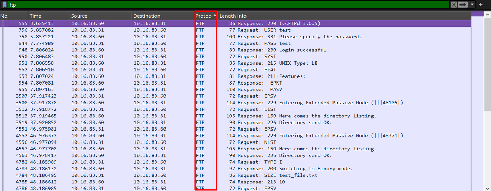
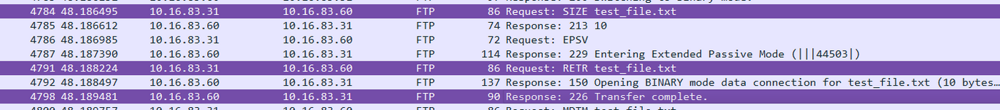
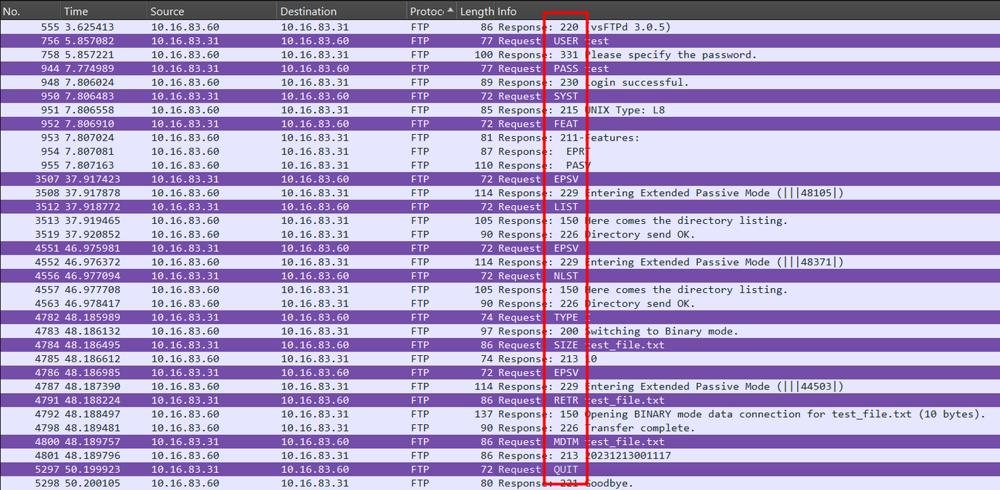

# Lab 06 · FTP traffic analysis

**Domain:** Network &nbsp;·&nbsp; **Tools:** Wireshark

## Purpose

To practise analysing a file-transfer session from a captured network dump, reading an FTP exchange in Wireshark and answering what protocol, hosts, credentials, and commands it contains.

## Overview

FTP sends everything in clear text, including the login. That makes it a perfect teaching capture: filter to `ftp` in Wireshark and the whole command channel reads like a transcript. The same property is also why FTP is unsafe in the real world, anyone who can see the traffic can read the username, password, and every command.

## Walkthrough

The capture was opened in Wireshark and filtered to `ftp`, which shows the command channel as a readable exchange of requests and responses.

Filtering to `ftp` strips the view down to the command channel, so the whole session reads as plain request-and-response lines.

**Protocol.** FTP (File Transfer Protocol). Every packet is labelled FTP, and the server's opening banner identifies it as vsFTPd 3.0.5. Because FTP is unencrypted, the credentials and commands below are all readable straight from the capture.

**Client and server IPs.**

The Source and Destination columns give the two ends of the conversation: client `10.16.83.31`, server `10.16.83.60`.

**Username and password.**

Because FTP is unencrypted, the login appears in plain text: username `test` (sent with `USER test`) and password `test` (sent with `PASS test`).

**Was the connection successful?**

After the password, the server replied `230 Login successful`, confirming the client was authenticated.

**Was a file downloaded?**

Yes: `test_file.txt` was requested with `RETR test_file.txt`, and the server responded `226 Transfer complete`.

**Commands the client sent.**

The full sequence, reading top to bottom: `USER`/`PASS` (login), `SYST` (server OS), `FEAT` (supported features), `EPSV` (open a data connection), `LIST`/`NLST` (list files), `TYPE I` (binary mode), `SIZE` (file size), `RETR` (download), `MDTM` (last-modified date), and `QUIT` (disconnect).

## Takeaway

A single FTP capture exposes the username, the password, and every command in plain text. The practical lesson is to use FTPS or SFTP instead, so none of this is readable on the wire.

> The IP addresses in this capture (`10.16.83.x`) belong to the lab's provided dump, not to my own machine.
