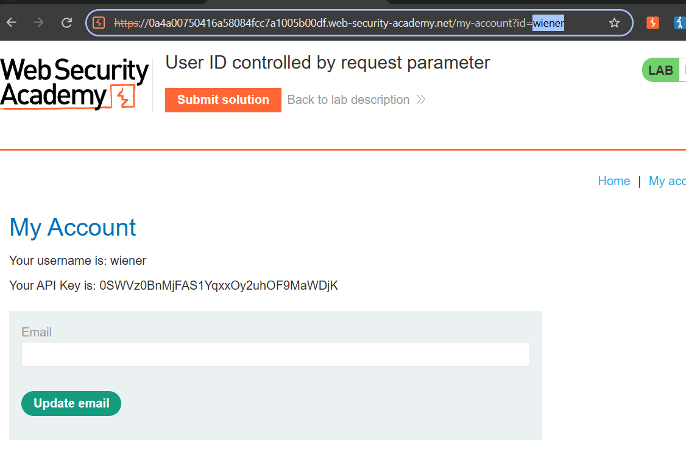
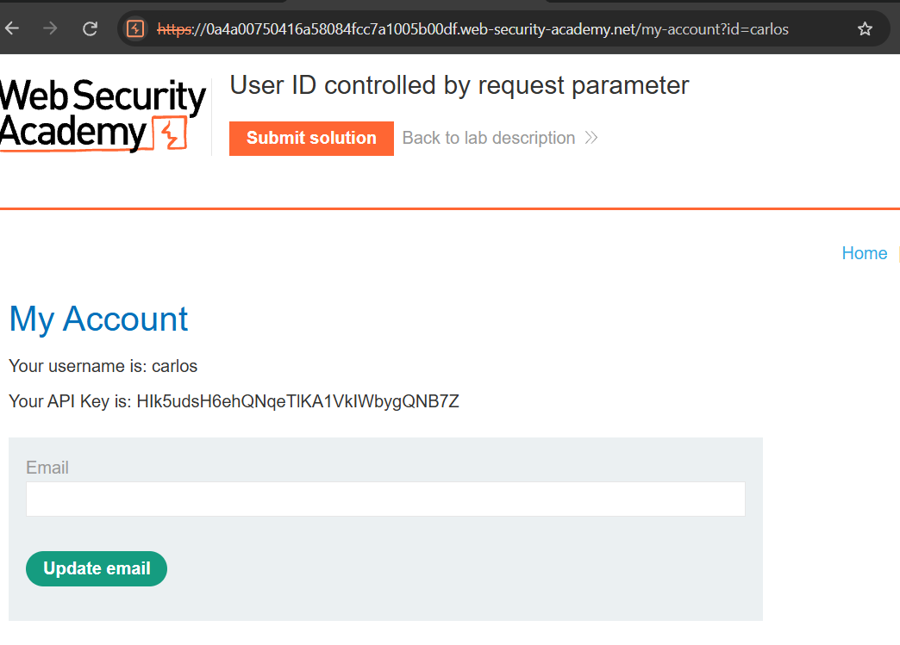
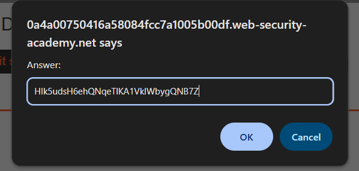
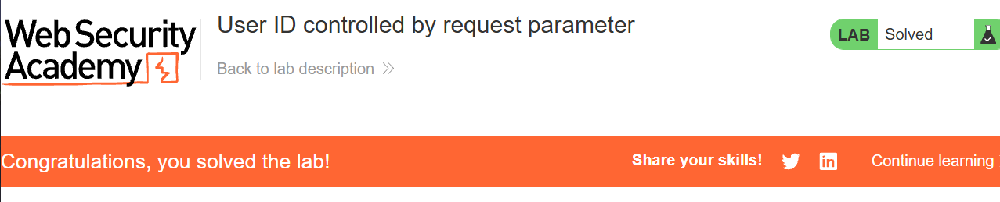

# Lab 01 · User ID controlled by request parameter

**Category:** Access control (IDOR) &nbsp;·&nbsp; **Difficulty:** Apprentice &nbsp;·&nbsp; **Tools:** Burp Suite

## Lab Description

> This lab is vulnerable because it uses a user ID supplied in a request parameter to load the account page, without checking that the ID belongs to the logged-in user.
>
> **Goal:** find the API key belonging to the user `carlos` and submit it as the solution.
> You can log in to your own account using the credentials `wiener:peter`.

## Overview

**Insecure Direct Object Reference (IDOR)** is a form of broken access control. It happens when an application exposes a reference to an internal object, such as a database row or an account, through a value the client controls, and then trusts that value without checking who is asking.

Here the account page is loaded from `/my-account?id=wiener`. The `id` in the URL is the object reference. If the server returns whatever account the `id` names without confirming it belongs to the current session, any user can read another user's data just by editing that value. This is **horizontal** privilege escalation: moving sideways to another user at the same level, rather than up to an admin.

## Solution

I logged in as the given user `wiener` and opened **My Account**. The page is loaded from a URL that carries my name as a parameter: `/my-account?id=wiener`.

This first shot is the baseline. It is my own account page: you can see `id=wiener` in the address bar, my username listed as `wiener`, and my own API key printed on the page. The `id` parameter is the value I am going to tamper with.

I changed the `id` in the URL from `wiener` to `carlos` and reloaded the page.

The page now shows carlos's account instead of mine. The username reads `carlos` and a different API key is displayed, the one the lab is asking for. Nothing stopped me: the server took the `id` straight from the URL and returned that account without ever checking that it belongs to me.

I copied carlos's API key and pasted it into the **Submit solution** box.

This is the key taken directly from carlos's account page in the previous step, entered as the lab's answer.

The banner turns green and the lab is marked solved, which confirms the key really was carlos's and that the IDOR worked.

## Root cause, impact and fix

| | |
| --- | --- |
| **Root cause** | The account is fetched by an `id` taken straight from the request, and the server never checks that the `id` belongs to the logged-in user. |
| **Impact** | Any user can read any other user's data by changing one value in the URL. |
| **Fix** | Check ownership on the server: only return the account when the requested `id` matches the current session's user, not just because the `id` was sent. |
| **Verify** | Log in as `wiener` and request `id=carlos` again. After the fix the server should refuse it, not return carlos's data. |
