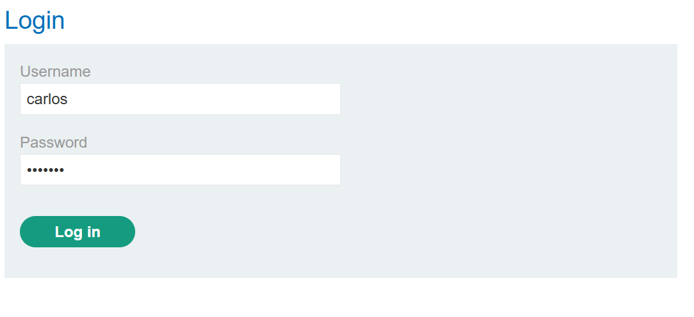
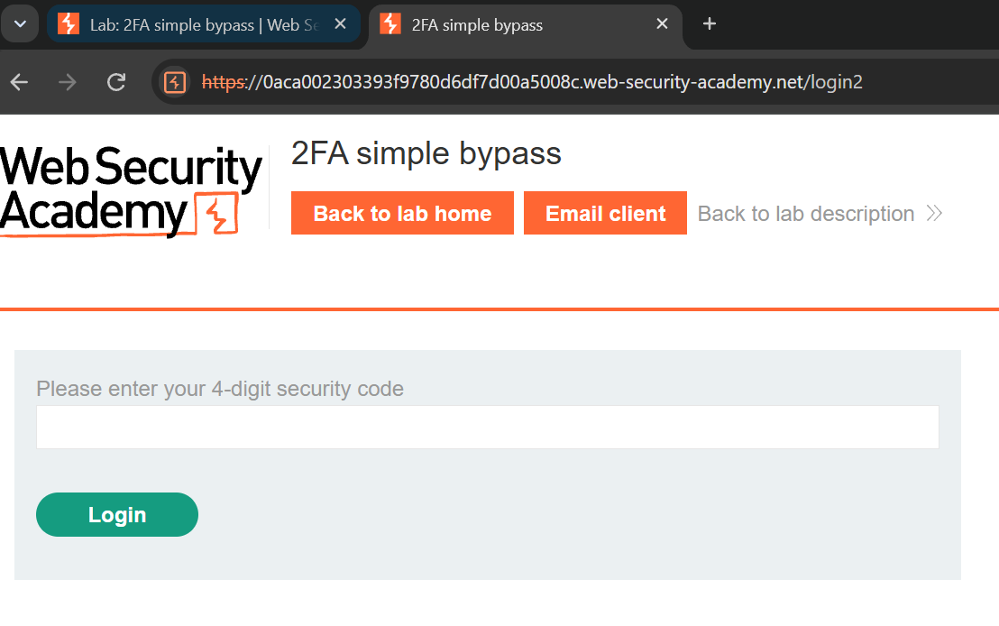
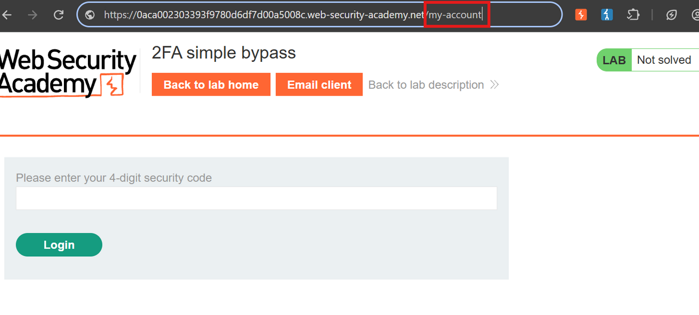
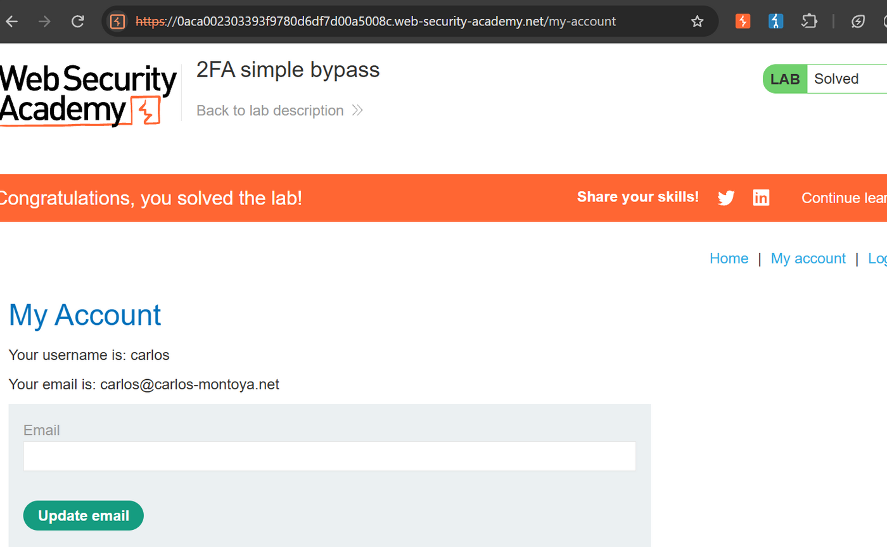

# Lab 04 · 2FA simple bypass

**Category:** Authentication &nbsp;·&nbsp; **Difficulty:** Apprentice &nbsp;·&nbsp; **Tools:** Browser

## Lab Description

> This lab's two-factor authentication is not properly enforced. After the password step the user is effectively logged in, so the verification page can be skipped.
>
> **Goal:** log in to the victim's account. Your own credentials are `wiener:peter`; the victim is `carlos:montoya`.

## Overview

Two-factor authentication only adds security if the session stays "not fully logged in" until the second factor is checked. If the application marks you as authenticated right after the password step and only *shows* you the 2FA page, then the code is a UI formality, not a gate. Anyone who skips straight to a protected page is let through.

## Solution

I logged in as `carlos` with the given password.

This is the normal first step, the password stage of the login.

This landed on the 2FA page at `/login2`, asking for a 4-digit code.

Here the app is asking for the second factor. The question is whether this page is actually enforced, or just displayed.

Instead of entering a code, I changed the URL straight to `/my-account`.

Rather than fill in a code I did not have, I navigated directly to a page that should only be reachable after full authentication.

The account page opened and the lab is solved. The 2FA step was never enforced: the session was already treated as logged in after the password.

## Root cause, impact and fix

| | |
| --- | --- |
| **Root cause** | The app treats the account as logged in after the password step, and never checks that the 2FA code was actually completed before serving protected pages. |
| **Impact** | Any user can skip the 2FA verification entirely by browsing to a post-login page, defeating the second factor. |
| **Fix** | Only mark a session as fully authenticated after the 2FA code is verified, and block access to protected pages until then. |
| **Verify** | Log in and browse to `/my-account` without entering a code after the fix. It should redirect back to the 2FA page, not open the account. |
