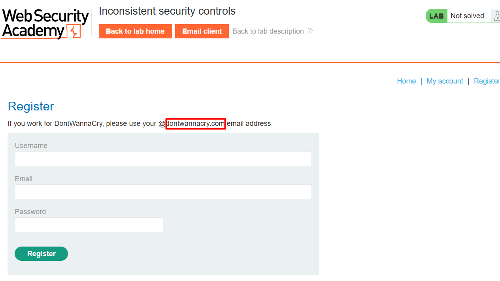
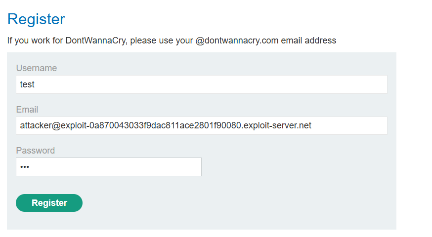
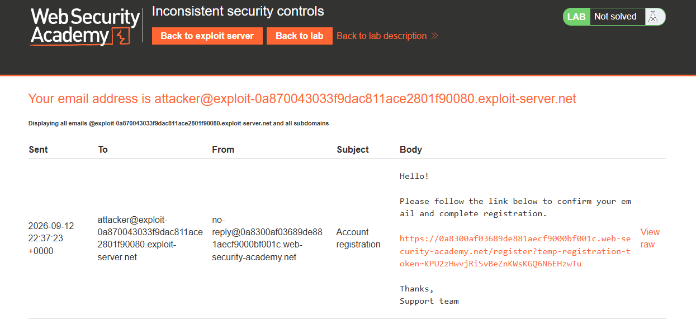
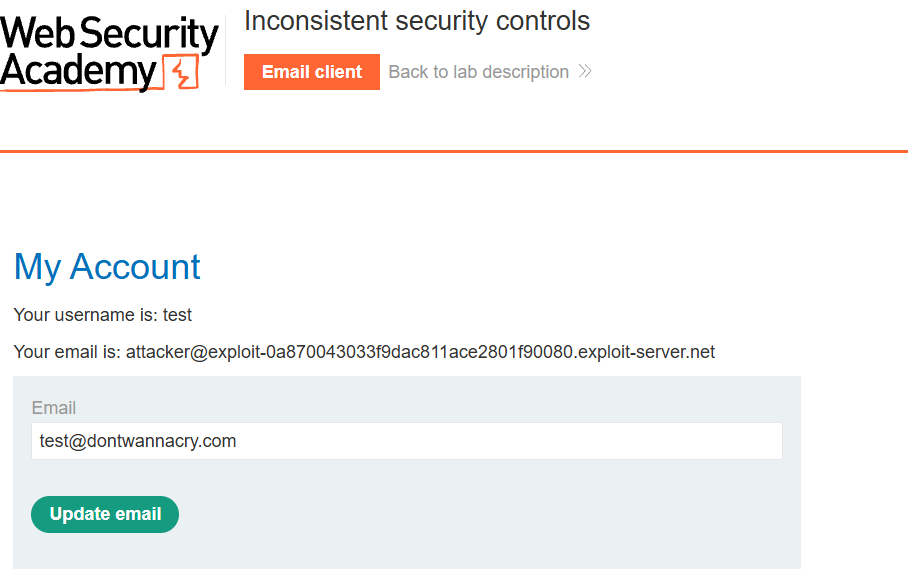
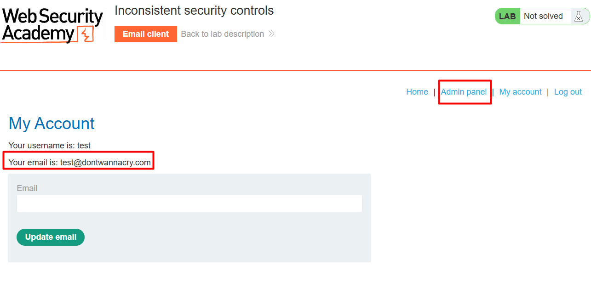
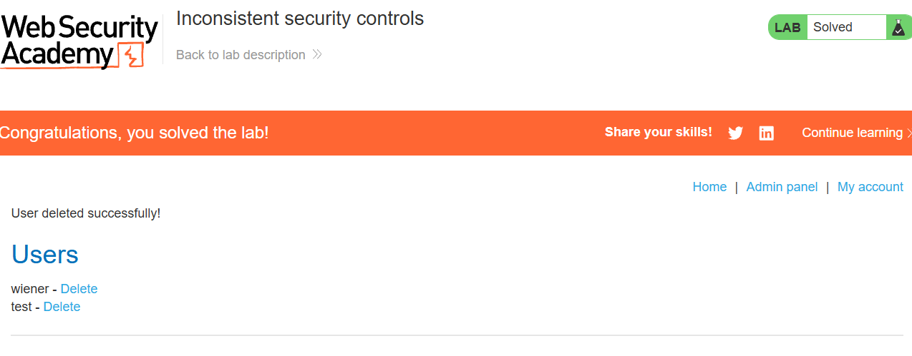

# Lab 07 · Inconsistent security controls

**Category:** Business logic &nbsp;·&nbsp; **Difficulty:** Practitioner &nbsp;·&nbsp; **Tools:** Burp Suite, exploit server

## Lab Description

> This lab grants admin access to anyone with a `@dontwannacry.com` email. Registration blocks that domain, but the email-change feature does not, so the control is applied inconsistently.
>
> **Goal:** register an account, gain admin access by claiming a privileged email, then delete the user `carlos`.

## Overview

A security rule is only as strong as its weakest enforcement point. Here privilege is tied to an email domain, and the domain is blocked at registration, but the same rule is missing from the update-email feature. One place enforces it, another does not, so a user simply takes the long way round: register with any address, then change it to the privileged one.

## Solution

The register page says staff must use a `@dontwannacry.com` email, which hints that domain gives privileges.

This hint is the whole lead: if staff use that domain, the app probably grants privileges based on it.

Registration won't accept that domain directly, so I first registered with the email address from my exploit server.

Since the privileged domain is blocked here, I register with an address I control on the exploit server, just to get a working account.

The confirmation email arrived on the exploit server, and I followed its link to finish registration.

The exploit server receives the confirmation email, and following its link activates the account.

Now logged in, I used the update-email feature to change my address to `test@dontwannacry.com`. This feature doesn't block the domain the way registration does.

This is the inconsistency in action: the update-email form accepts the exact domain that registration refused.

With a `@dontwannacry.com` address, an Admin panel link appeared, so the app granted admin from the email domain alone.

The Admin panel link appearing confirms privilege is granted purely from the email domain, now that I hold a privileged address.

From the admin panel I deleted `carlos`, which solves the lab.

Deleting carlos is the final step, and the lab is marked solved.

## Root cause, impact and fix

| | |
| --- | --- |
| **Root cause** | Privilege is granted by email domain, but the rule is enforced only at registration, not on the email-change feature. |
| **Impact** | A user can register with any email, then change it to a privileged `@dontwannacry.com` address and gain admin. |
| **Fix** | Apply the same domain rule everywhere an email is set, and do not grant privileges from an email domain at all; use explicit roles instead. |
| **Verify** | Change an account's email to a `@dontwannacry.com` address after the fix. It should be refused, or grant no extra privilege. |
